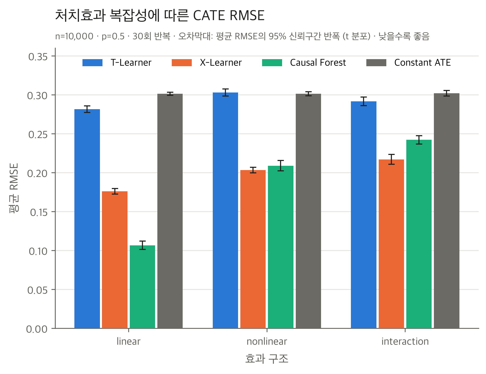
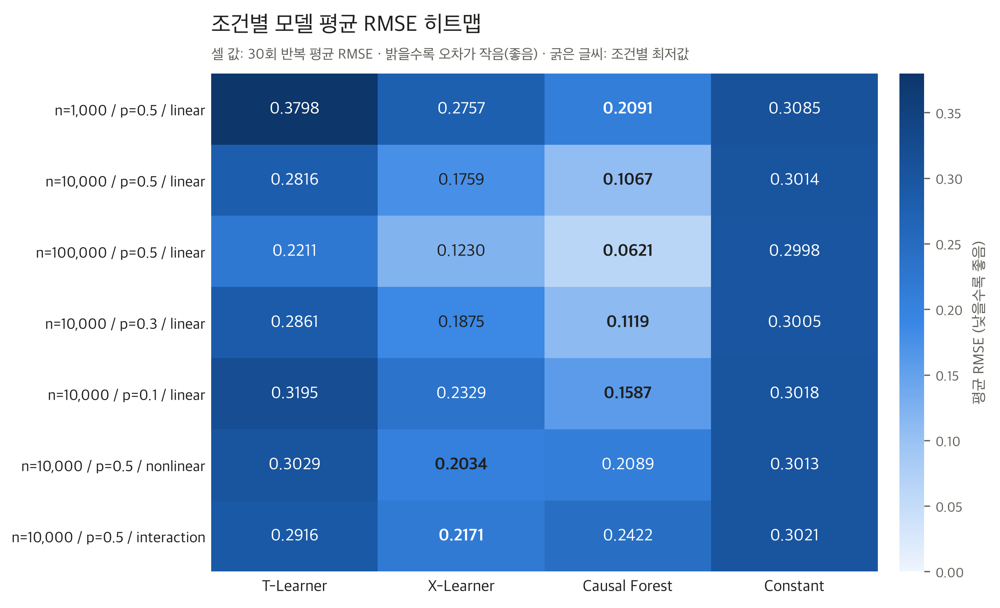

# 데이터 특성에 따른 CATE 추정 모델의 성능 비교 연구

| 단계 | 내용 | 상태 |
|---|---|---|
| STEP 1 | 프로젝트 구성 + 합성 데이터 생성 파이프라인 | 완료 |
| STEP 2 | 모델 구현 + 예비 실험 1회 (n=1,000, p=0.5, linear) | 완료 |
| STEP 3 | 반복 실험 자동화 + 시험 실행, 자원 점검 | 완료 |
| STEP 4 | 정식 OFAT 시뮬레이션 (7개 조건 × 30회 = 210회) + 최종 그래프 5종·결과표 6종 | **완료** |
| — | Spearman 순위 상관계수 평가 | **미실시** (계획됨) |
| — | Criteo Uplift 실데이터 분석 (Qini curve, AUUC, 타기팅 비율별 증분 전환) | **미실시** (예정) |

## 1. 프로젝트 소개

### 연구 목적과 연구 질문

마케팅·의료·정책 분야에서는 "처치가 평균적으로 효과가 있는가"보다 "**누구에게** 효과가 있는가"가 중요한 경우가 많습니다. 이 연구는 대표적인 CATE 추정 모델 세 가지를 통제된 합성 데이터에서 비교하여, 데이터 특성에 따라 어떤 모델이 더 정확하고 안정적인지 확인합니다.

> **연구 질문.** 표본 크기, 처치군 불균형, 처치효과의 복잡성에 따라 CATE 추정 모델의 정확도(RMSE)와 안정성(반복 간 변동)은 어떻게 달라지는가?

### CATE란

조건부 평균 처치효과(Conditional Average Treatment Effect)는 공변량 $x$를 가진 개체에서 처치 여부에 따른 결과 차이의 기댓값입니다.

$$\tau(x) = E[\,Y(1) - Y(0) \mid X = x\,]$$

전체 평균효과(ATE)와 달리 개체 특성별 효과 차이(이질성)를 추정하므로, 캠페인·쿠폰 대상 선정(uplift modeling), 환자별 치료 효과 예측, 정책 수혜 대상 선별 등에 활용됩니다.

### 비교 모델

- **T-Learner**: 처치군·대조군 결과 모델을 따로 학습하고 예측값의 차이를 CATE로 사용
- **X-Learner**: T-Learner의 결과 모델로 개체별 대리 효과를 만들고, 이를 다시 학습해 성향점수로 가중 결합
- **Causal Forest**: 처치효과 이질성을 직접 분할 기준으로 사용하는 포레스트 (`econml.dml.CausalForestDML`)
- (기준선) **Constant ATE**: 학습 데이터의 처치군·대조군 평균 차이를 모든 개체에 동일하게 예측. 이질성을 학습하지 않는 모델로, 세 모델이 이 기준보다 나은지 확인하는 용도입니다.

## 2. 연구 설계

### 시뮬레이션 데이터 생성 (`src/data_generation.py`)

$$
X_1,\dots,X_{10} \overset{iid}{\sim} N(0,1),\quad
T \sim \text{Bernoulli}(p),\quad
Y = \mu_0(X) + T\,\tau(X) + \varepsilon,\quad \varepsilon \sim N(0,1)
$$

$$
\mu_0(X) = 0.2X_1 - 0.1X_2 + 0.3X_3
$$

| 변수 | 의미 |
|---|---|
| `X1`~`X10` | 공변량. X4~X10은 결과에 영향이 없는 잡음 공변량 |
| `T` | 처치 여부(0/1). X와 독립인 **무작위 배정**(성향점수 = p로 상수) |
| `Y` | 관측 결과 |
| `true_cate` | 참 처치효과 $\tau(X)$. **평가(채점)에만 사용**하며 모델 입력에서 제외 |
| `mu0` | 비처치 기대 결과. 진단용이며 모델 입력에서 제외 |

교란(confounding)은 의도적으로 배제하여, 모델 간 차이가 표본 크기·불균형·효과 복잡성에서만 오도록 했습니다.

### 처치효과 구조

세 함수는 모두 $\tau(X) = 0.5 + 0.3\,g(X)$ 형태이며, $g$는 $X \sim N(0, I)$에서 이론적 평균 0, 분산 1을 갖도록 설계했습니다. 따라서 모든 구조에서 $E[\tau]=0.5$, $SD[\tau]=0.3$으로 같고 **함수 형태만** 달라집니다.

| effect | $g(X)$ | 특징 |
|---|---|---|
| `linear` | $X_1$ | 기준 조건 |
| `nonlinear` | $\dfrac{1}{\sqrt2}\left[\dfrac{X_1^2-1}{\sqrt2} + \dfrac{\sin(\pi X_2)}{s}\right]$, $s=\sqrt{(1-e^{-2\pi^2})/2}$ | U자형(이차항) + 주기형(사인)의 가법 구조. X와의 선형 상관이 거의 0 |
| `interaction` | $X_1 X_2$ | 주효과 없는 순수 상호작용 |

기준 표본(n=200,000, seed=42)에서 세 구조 모두 mean ≈ 0.50, sd ≈ 0.30이고, X에 대한 선형회귀 설명력(`linear_r2`)만 1.000 / 0.001 / 0.000으로 달라집니다. 단, 분포 모양은 다릅니다(`nonlinear`은 skew ≈ 1, `interaction`은 꼬리가 두꺼움).

### OFAT 설계와 7개 고유 조건 (`configs/experiment.yaml`)

기준 조건(n=10,000, p=0.5, linear)을 두고 한 번에 한 요인만 바꾸는 OFAT(one-factor-at-a-time) 설계입니다. 세 실험이 기준 조건(c01)을 공유하므로 고유 조건은 7개입니다.

| 조건 | n | 처치군 비율 p | 효과 구조 | 소속 실험 |
|---|---|---|---|---|
| c00 | 1,000 | 0.5 | linear | 표본 크기 |
| c01 | 10,000 | 0.5 | linear | 표본 크기 · 처치 비율 · 복잡성 (기준) |
| c02 | 100,000 | 0.5 | linear | 표본 크기 |
| c03 | 10,000 | 0.3 | linear | 처치 비율 |
| c04 | 10,000 | 0.1 | linear | 처치 비율 |
| c05 | 10,000 | 0.5 | nonlinear | 복잡성 |
| c06 | 10,000 | 0.5 | interaction | 복잡성 |

- 각 조건 **30회 반복, 총 210회** (모델 4개 × 210 = `formal_runs.csv` 840행)
- 잡음 SD = 1.0 고정
- 27개 조건 완전요인설계(`--design full`)는 코드에 구현되어 있으나 **실행하지 않았습니다.**

### Seed 규칙과 데이터 분할

반복 번호 r에 대해

- **data_seed = 42 + r**: 데이터 생성과 학습/테스트 분할
- **model_seed = 1000 + r**: 세 모델 모두

같은 반복 안에서는 세 모델과 Constant ATE가 **동일한 데이터와 동일한 80/20 분할**(T로 층화)을 사용합니다. 반복이 다르면 seed가 달라 독립적인 데이터가 생성됩니다. 또한 같은 반복의 서로 다른 조건은 같은 data_seed를 공유하므로(공통 난수), 조건 간 짝비교에서 표본 잡음 차이가 줄어듭니다.

### 고정 하이퍼파라미터 (`configs/models.yaml`)

모든 하이퍼파라미터는 실험 전에 고정했으며, 조건별 튜닝은 하지 않았습니다.

| 항목 | 값 |
|---|---|
| RF 기본 학습기 (T/X-Learner 전 단계, CF의 `model_y`) | `n_estimators=200, min_samples_leaf=5, max_features=1.0` |
| X-Learner 성향점수 | 설계 처치 비율 p (무작위 배정) |
| Causal Forest | `n_estimators=1000, min_samples_leaf=5, max_features=1.0, honest=True, cv=5`, `model_t`=상수 성향점수(`DummyClassifier(prior)`) |
| 병렬화 | 모든 모델 `n_jobs=1` |
| 분할 | test_size=0.2, T로 층화 |

## 3. 모델 및 평가 지표

### 모델 구현 (`src/models.py`)

세 모델은 모두 `fit(X, T, Y)` / `effect(X)` 인터페이스를 따르며, 입력은 **X1~X10, T, Y로만** 제한됩니다(`src/evaluation.py::extract_model_inputs`). 테스트에서 `true_cate`·`mu0`를 바꿔도 예측이 변하지 않음을 확인합니다(누수 방지).

| | T-Learner | X-Learner | Causal Forest |
|---|---|---|---|
| 1단계 | $\hat\mu_0, \hat\mu_1$ 학습 | $\hat\mu_0, \hat\mu_1$ 학습 | 교차적합(5-fold)으로 Y, T 잔차화 |
| CATE | $\hat\mu_1(x) - \hat\mu_0(x)$ | 대리 효과 $D_1 = Y - \hat\mu_0(X)$(처치군), $D_0 = \hat\mu_1(X) - Y$(대조군)를 학습한 뒤 $e\,\hat\tau_0(x) + (1-e)\,\hat\tau_1(x)$ | 잔차 간 국소 회귀 계수를 GRF로 직접 추정 |
| 특징 | 두 모델의 오차가 차이에 누적되기 쉬움 | 처치군 불균형에 대응하도록 설계 | Honest 분할, 효과 이질성 기준 분할 |

### 평가 지표

| 지표 | 정의 | 상태 |
|---|---|---|
| RMSE | 테스트 세트(20%)에서 $\sqrt{\text{mean}((\hat\tau - \tau)^2)}$ | 계산 완료 (주 지표) |
| MAE | 테스트 세트에서 $\text{mean}(|\hat\tau - \tau|)$ | 계산 완료 |
| 반복 간 표준편차 | 30회 반복 RMSE의 표본 표준편차 (안정성) | 계산 완료 |
| 95% 신뢰구간 | 평균 RMSE ± $t_{0.975,29}$ × SD / √30 | 계산 완료 |
| 짝비교 | 같은 조건·같은 반복의 RMSE 차이에 대한 대응 t검정 | 계산 완료 |
| Holm 다중검정 보정 | 모델 간 비교: 조건 내 6개 모델 쌍 / 조건 간 비교: 표본 크기 12개, 처치 비율 8개, 복잡성 8개 | 계산 완료 |
| **Spearman 순위 상관계수** | 참 CATE와 예측 CATE의 순위 일치도 (타기팅 관점) | **계획된 지표이나 아직 계산하지 않음** |

> Spearman 관련: 현재 `formal_runs.csv`에는 반복별 요약 지표만 저장되어 있고 개체별 예측값은 저장되어 있지 않습니다. 따라서 정식 실험 결과로 Spearman을 계산하려면 예측값 저장 기능을 추가한 뒤 재실행이 필요할 수 있습니다.

## 4. 최종 실험 결과

아래 수치는 모두 `results/tables/formal_summary.csv`, `formal_paired.csv` 및 조건 간 비교 CSV에서 읽은 값입니다(30회 반복, 소수점 4자리).

### 조건별 평균 RMSE ± 표준편차

| 조건 | 설정 | T-Learner | X-Learner | Causal Forest | Constant ATE |
|---|---|---|---|---|---|
| c00 | n=1,000 / p=0.5 / linear | 0.3798 ± 0.0374 | 0.2757 ± 0.0445 | **0.2091 ± 0.0336** | 0.3085 ± 0.0189 |
| c01 | n=10,000 / p=0.5 / linear | 0.2816 ± 0.0112 | 0.1759 ± 0.0096 | **0.1067 ± 0.0144** | 0.3014 ± 0.0051 |
| c02 | n=100,000 / p=0.5 / linear | 0.2211 ± 0.0032 | 0.1230 ± 0.0028 | **0.0621 ± 0.0035** | 0.2998 ± 0.0018 |
| c03 | n=10,000 / p=0.3 / linear | 0.2861 ± 0.0105 | 0.1875 ± 0.0097 | **0.1119 ± 0.0134** | 0.3005 ± 0.0048 |
| c04 | n=10,000 / p=0.1 / linear | 0.3195 ± 0.0136 | 0.2329 ± 0.0126 | **0.1587 ± 0.0203** | 0.3018 ± 0.0053 |
| c05 | n=10,000 / p=0.5 / nonlinear | 0.3029 ± 0.0123 | **0.2034 ± 0.0098**† | 0.2089 ± 0.0180 | 0.3013 ± 0.0066 |
| c06 | n=10,000 / p=0.5 / interaction | 0.2916 ± 0.0146 | **0.2171 ± 0.0172** | 0.2422 ± 0.0144 | 0.3021 ± 0.0096 |

굵은 글씨는 조건별 평균 RMSE 최저값입니다(평균값 기준 표시이며, 그 자체로 통계적 우위를 뜻하지 않음).
† c05에서 X-Learner와 Causal Forest의 차이는 통계적으로 유의하지 않습니다(아래 참조).

### 핵심 결과

1. **표본 크기가 커질수록 세 모델의 RMSE가 감소했습니다.** n=1,000 → 100,000에서 T −41.8%, X −55.4%, CF −70.3%이며, 1k→10k, 10k→100k 각 구간에서도 30회 모두 감소했습니다(Holm 보정 p < 0.0001, 보정 범위 12개 비교). Constant ATE는 약 0.30에 머물렀고 변화가 유의하지 않았습니다.
2. **처치군 비율 10%에서 세 모델 모두 오차가 증가했습니다.** p=0.5 대비 p=0.1의 평균 RMSE 변화는 T +13.5%, X +32.4%, CF +48.8%로 모두 유의했습니다(Holm, 보정 범위 8개 비교). p=0.3에서는 X만 유의하게 증가했고(+6.6%), T(+1.6%)와 CF(+5.0%)는 유의하지 않았습니다.
3. **p=0.1에서 T-Learner의 RMSE(0.3195)는 Constant ATE(0.3018)보다 높았습니다.** 짝차이 +0.0177, 95% CI [0.0121, 0.0232], Holm p < 0.0001이며, 30회 중 T가 더 나았던 반복은 3회입니다.
4. **선형 효과에서는 Causal Forest가 가장 정확했습니다.** 선형 5개 조건(c00~c04) 모두에서 CF가 X-Learner보다 유의하게 낮았습니다(Holm p < 0.0001).
5. **비선형 효과에서는 X-Learner와 Causal Forest의 차이가 통계적으로 확인되지 않았습니다.** X − CF = −0.0056, 95% CI [−0.0112, 0.0001], Holm p = 0.1059 (X가 더 나은 반복 20/30). 같은 조건에서 T-Learner와 Constant ATE의 차이도 유의하지 않았습니다(Holm p = 0.4878).
6. **상호작용 효과에서는 X-Learner가 Causal Forest보다 유의하게 정확했습니다.** X − CF = −0.0251, 95% CI [−0.0286, −0.0216], Holm p < 0.0001, 30회 모두 X가 더 낮았습니다.

추가로, 선형 → 비선형/상호작용으로 바뀔 때 CF의 RMSE는 +95.9% / +127.1% 증가해 세 모델 중 가장 크게 악화되었습니다(X +15.6% / +23.4%, T +7.6% / +3.6%).

> 위 결과는 무작위 배정 합성 데이터, 고정 하이퍼파라미터, OFAT 설계라는 조건에 한정됩니다(8. 연구의 한계 참조).

## 5. 그래프 및 결과표

### 대표 그래프

**표본 크기에 따른 CATE RMSE** — 오차막대: 평균 RMSE의 95% 신뢰구간 반폭


**처치효과 복잡성에 따른 CATE RMSE** — 오차막대: 평균 RMSE의 95% 신뢰구간 반폭



**조건별 모델 평균 RMSE 히트맵** — 밝을수록 오차가 작음, 굵은 숫자는 조건별 최저값



### 전체 그래프 5종 ([results/figures/final_step4/](results/figures/final_step4/))

각 그래프는 PNG(300dpi)와 PDF로 저장되어 있으며, 캡션(`*_caption.txt`)과 그래프 수치(`final_plot_data_*.csv`)가 함께 있습니다.

| 그래프 | PNG | PDF | 캡션 |
|---|---|---|---|
| 표본 크기별 RMSE | [png](results/figures/final_step4/sample_size_rmse.png) | [pdf](results/figures/final_step4/sample_size_rmse.pdf) | [txt](results/figures/final_step4/sample_size_rmse_caption.txt) |
| 처치군 비율별 RMSE | [png](results/figures/final_step4/treatment_ratio_rmse.png) | [pdf](results/figures/final_step4/treatment_ratio_rmse.pdf) | [txt](results/figures/final_step4/treatment_ratio_rmse_caption.txt) |
| 효과 복잡성별 RMSE | [png](results/figures/final_step4/effect_complexity_rmse.png) | [pdf](results/figures/final_step4/effect_complexity_rmse.pdf) | [txt](results/figures/final_step4/effect_complexity_rmse_caption.txt) |
| 조건별 안정성(RMSE SD) | [png](results/figures/final_step4/model_stability_sd.png) | [pdf](results/figures/final_step4/model_stability_sd.pdf) | [txt](results/figures/final_step4/model_stability_sd_caption.txt) |
| 평균 RMSE 히트맵 | [png](results/figures/final_step4/rmse_heatmap.png) | [pdf](results/figures/final_step4/rmse_heatmap.pdf) | [txt](results/figures/final_step4/rmse_heatmap_caption.txt) |

### 논문용 결과표 6종 ([results/figures/final_step4/tables/](results/figures/final_step4/tables/))

각 표는 PNG(300dpi), 벡터 PDF, 편집용 CSV로 저장되어 있습니다.

| 표 | 내용 | PNG | PDF | CSV |
|---|---|---|---|---|
| Table 1 | 전체 7개 조건 평균 RMSE ± SD | [png](results/figures/final_step4/tables/table01_overall_rmse.png) | [pdf](results/figures/final_step4/tables/table01_overall_rmse.pdf) | [csv](results/figures/final_step4/tables/table01_overall_rmse.csv) |
| Table 2 | 표본 크기별 성능과 변화율 | [png](results/figures/final_step4/tables/table02_sample_size.png) | [pdf](results/figures/final_step4/tables/table02_sample_size.pdf) | [csv](results/figures/final_step4/tables/table02_sample_size.csv) |
| Table 3 | 처치군 비율별 성능과 변화율 | [png](results/figures/final_step4/tables/table03_treatment_ratio.png) | [pdf](results/figures/final_step4/tables/table03_treatment_ratio.pdf) | [csv](results/figures/final_step4/tables/table03_treatment_ratio.csv) |
| Table 4 | 효과 복잡성별 성능과 변화율 | [png](results/figures/final_step4/tables/table04_effect_complexity.png) | [pdf](results/figures/final_step4/tables/table04_effect_complexity.pdf) | [csv](results/figures/final_step4/tables/table04_effect_complexity.csv) |
| Table 5 | 안정성: 반복 간 SD(Panel A), 평균의 95% CI(Panel B) | [png](results/figures/final_step4/tables/table05_model_stability.png) | [pdf](results/figures/final_step4/tables/table05_model_stability.pdf) | [csv](results/figures/final_step4/tables/table05_model_stability.csv) |
| Table 6 | 핵심 모델 간 짝비교 (Holm 보정) | [png](results/figures/final_step4/tables/table06_statistical_comparison.png) | [pdf](results/figures/final_step4/tables/table06_statistical_comparison.pdf) | [csv](results/figures/final_step4/tables/table06_statistical_comparison.csv) |

## 6. 프로젝트 구조

```text
cate-benchmark/
├── src/                      # 핵심 로직
│   ├── data_generation.py    #   DGP, 효과 함수, 진단 통계량, 데이터 저장
│   ├── models.py             #   T-Learner, X-Learner, CausalForestDML 래퍼
│   ├── evaluation.py         #   층화 분할, 입력 추출(누수 방지), RMSE/MAE, Constant ATE
│   └── simulation.py         #   OFAT 조건 생성, 반복 1회 실행, 요약·짝비교 통계, 이어하기 검사
├── scripts/                  # 실행 진입점
│   ├── generate_data.py      #   단일 합성 데이터셋 생성 (CSV + 메타데이터)
│   ├── run_pilot.py          #   예비 실험 1회 (STEP 2)
│   ├── run_simulation.py     #   반복 시뮬레이션 실험 (STEP 3~4)
│   └── memory_guard.py       #   메모리 상한 감시 래퍼 (n=100,000 실행 시 사용)
├── configs/
│   ├── simulation.yaml       #   단일 데이터 생성 기본값 + 27개 조건 그리드
│   ├── models.yaml           #   사전 고정 하이퍼파라미터 + 분할 설정
│   └── experiment.yaml       #   반복 실험 설계 (기준 조건, 요인 수준, 반복 수, seed)
├── tests/                    # pytest 검증 (79개)
├── data/
│   ├── synthetic/            #   generate_data.py 출력 (Git 제외)
│   └── criteo/               #   Criteo 원본 데이터 위치 (Git 제외, 아직 미사용)
└── results/
    ├── tables/               #   정식 실험 결과 formal_*.csv / formal_metadata.json (Git 포함)
    └── figures/final_step4/  #   최종 그래프 5종 + tables/ 결과표 6종 (Git 포함)
```

`results/tables/`의 주요 파일:

| 파일 | 내용 |
|---|---|
| `formal_runs.csv` | 반복 × 모델별 RMSE, MAE, 학습 시간, 예측 평균·SD, seed, 집단별 표본 수, peak RSS (840행) |
| `formal_summary.csv` | 조건 × 모델별 RMSE·MAE 평균, SD, 95% CI, 학습 시간 |
| `formal_paired.csv` | 조건 내 모델 쌍별 RMSE 짝차이, 95% CI, p값, Holm 보정 p값 |
| `formal_sample_size_comparison.csv` | 표본 크기 간 짝비교 (Holm, 12개 비교) |
| `formal_treat_ratio_comparison.csv` | 처치 비율 간 짝비교 (Holm, 8개 비교) |
| `formal_complexity_comparison.csv` | 효과 구조 간 짝비교 (Holm, 8개 비교) |
| `formal_metadata.json` | 설계, 조건, seed 규칙, 모델 설정, 실행 이력, 환경 |

예비·시험 실행 결과(`pilot_*`, `trial_*`, `probe_*`)와 메모리 로그는 로컬에만 있으며 Git에서 제외됩니다.

## 7. 실행 및 재현 방법

### 환경 설정

Python 3.11 이상이 필요합니다(정식 실험은 Python 3.13.9, macOS arm64에서 실행).

```bash
python3 -m venv .venv
source .venv/bin/activate          # Windows PowerShell: .venv\Scripts\Activate.ps1
pip install -r requirements.txt
```

> conda가 활성화되어 있으면 `python3`가 3.11 미만을 가리킬 수 있습니다. `conda deactivate` 후 진행하거나 3.11+ 인터프리터의 전체 경로를 지정하세요.

정식 실험 환경: numpy 2.5.4, pandas 2.3.3, scikit-learn 1.9.1, econml 0.17.0, scipy 1.18.1 (`formal_metadata.json`에 기록).

### 테스트

```bash
pytest            # 79개 테스트 (데이터 생성 37, 모델 15, 시뮬레이션 27)
```

### 데이터 생성 · 예비 실험

```bash
python scripts/generate_data.py                                   # n=1000, p=0.5, linear, seed=42
python scripts/generate_data.py --n 10000 --treat-prob 0.1 --effect interaction
python scripts/run_pilot.py                                       # 예비 실험 1회 (위 기본 데이터 필요)
```

반복 시뮬레이션(`run_simulation.py`)은 각 반복에서 데이터를 메모리에서 직접 생성하므로, `generate_data.py`를 먼저 실행할 필요가 없습니다.

### 반복 시뮬레이션 실험

```bash
python scripts/run_simulation.py --tag formal --list-conditions    # 조건 ID와 완료 반복 수 확인 (파일 변경 없음)
```

정식 결과(`formal_*`)는 이미 7개 조건 × 30회가 완료되어 있으므로, 같은 tag로 `--resume` 실행하면 학습 없이 종료됩니다. **기존 결과를 보존하려면 재현 실행 시 다른 tag를 사용하세요.**

```bash
# 예: c00 조건을 새 tag로 재현 (같은 seed 규칙 → 같은 결과)
python scripts/run_simulation.py --tag repro --condition-id c00

# 여러 조건 / 중단 후 이어서 실행
python scripts/run_simulation.py --tag repro --condition-id c01 c03 --resume

# n=100,000(c02): 5회씩 나누어 실행, 메모리 상한 감시
python scripts/memory_guard.py --limit-mb 7000 --interval 5 --log results/tables/repro_c02_memory.csv -- \
  python scripts/run_simulation.py --tag repro --condition-id c02 --resume --max-new-reps 5
```

주요 옵션:

| 옵션 | 동작 |
|---|---|
| `--condition-id ID ...` | 지정한 조건만 실행 (c00~c06) |
| `--resume` | 완료된 (조건, 반복)을 건너뜀. 기존 결과의 중복·누락·seed 규칙을 먼저 검사 |
| `--max-new-reps K` | 미완료 반복 중 앞의 K개만 실행 후 종료 |
| `--overwrite` | 결과 파일을 새로 시작. 선택 밖 조건의 결과가 들어 있으면 거부 |
| `--design full` | 27개 조건 완전요인설계 (구현만 되어 있고 실행하지 않음) |

같은 tag의 결과 파일이 있으면 `--resume` 또는 `--overwrite` 없이는 실행되지 않습니다.

실측 소요 시간(Apple M5, 모든 모델 단일 스레드): 반복 1회당 n=1,000 약 3초, n=10,000 약 44~48초, n=100,000 약 741초. 정식 실험 210회 전체는 약 8.1시간입니다.

### 결과 확인 · 그래프와 표 재생성

- 결과 CSV: `results/tables/formal_summary.csv`(요약), `formal_paired.csv`(모델 간 비교)
- 그래프·표는 저장된 CSV만 읽어 생성합니다(재학습 없음).

```bash
python results/figures/final_step4/make_final_plots.py            # 그래프 5종 + final_plot_data_*.csv + 캡션
python results/figures/final_step4/tables/make_final_tables.py    # 결과표 6종 (수치 교차검증 포함)
```

## 8. 연구의 한계

- **고정된 하이퍼파라미터.** 모든 조건에서 같은 설정(예: `min_samples_leaf=5`)을 사용했습니다. 결과는 "각 모델의 최적 성능" 비교가 아니며, 튜닝에 따라 순위가 달라질 수 있습니다.
- **OFAT 설계.** 한 번에 한 요인만 바꾸므로 요인 간 상호작용(예: 작은 n × 낮은 p, 비선형 × 불균형)은 검증하지 않았습니다.
- **시뮬레이션 데이터 생성 방식의 제한.** 무작위 배정(교란 없음, 성향점수 알려짐), 정규 공변량 10개, 고정된 기저 결과 함수와 잡음 수준, 세 가지 효과 함수만 다룹니다. 효과 구조 간 분포 모양(왜도·꼬리)도 다릅니다.
- **표본 크기에 따른 테스트 데이터 크기 차이.** 테스트 세트는 전체의 20%(200~20,000개)이므로, 큰 n에서 반복 간 SD가 작아진 데에는 RMSE 측정 잡음 감소도 일부 기여합니다.
- **다중검정 범위.** Holm 보정은 각 비교 묶음(조건 내 6쌍, 조건 간 12·8·8개) 안에서만 적용했으며, 연구 전체의 모든 검정을 아우르지 않습니다. 조건들은 공통 난수를 공유하므로 서로 독립 표본이 아닙니다.
- **실제 데이터 일반화.** 결과가 관측 데이터나 실제 uplift 데이터(Criteo 등)에도 그대로 성립하는지는 확인하지 않았습니다.

## 9. 향후 계획

아래 작업은 **아직 진행하지 않았습니다.**

- **Spearman 순위 상관계수.** 참 CATE와 예측 CATE의 순위 일치도를 계산할 수 있는지 확인하고 보완합니다(예측값 저장 기능 추가 및 재실행 필요 여부 검토).
- **Criteo Uplift 데이터 분석.** treatment = 캠페인 배정, outcome = conversion으로 설정해 실제 데이터에서 세 모델을 비교합니다.
- **Qini curve 및 AUUC 평가.** 실제 데이터에는 참 CATE가 없으므로 순위 기반 uplift 지표로 평가합니다.
- **상위 타기팅 비율별 증분 전환 분석.** 예측 CATE 상위 k% 타기팅 시의 증분 전환 성과를 비교합니다.
