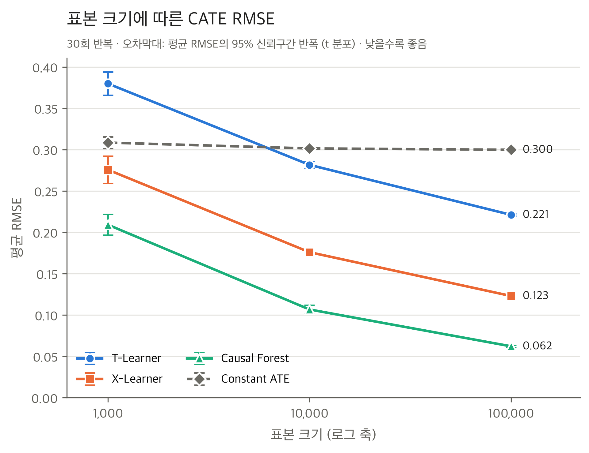
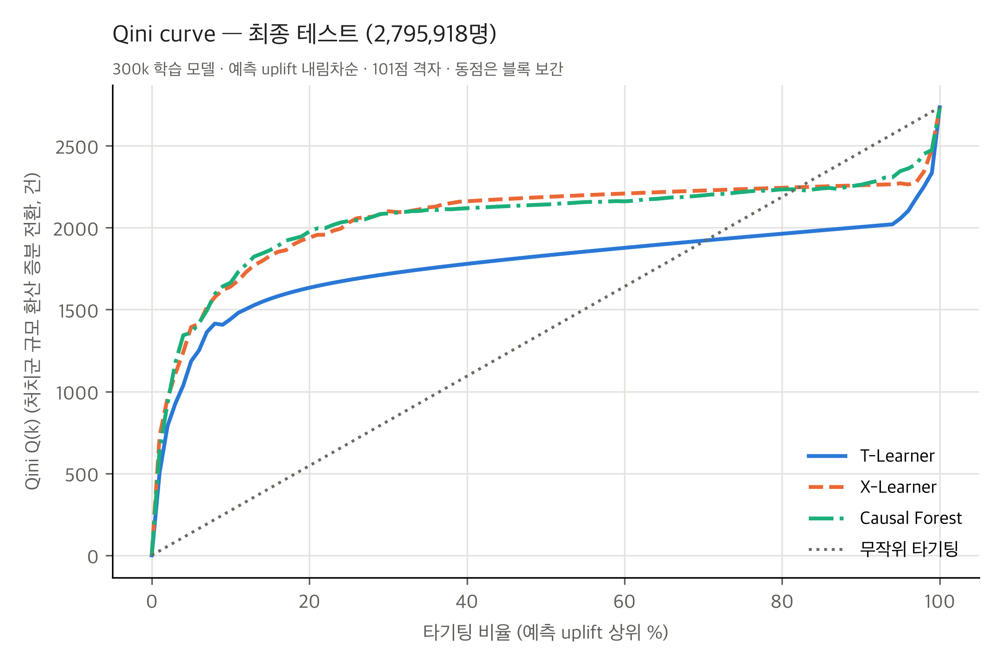
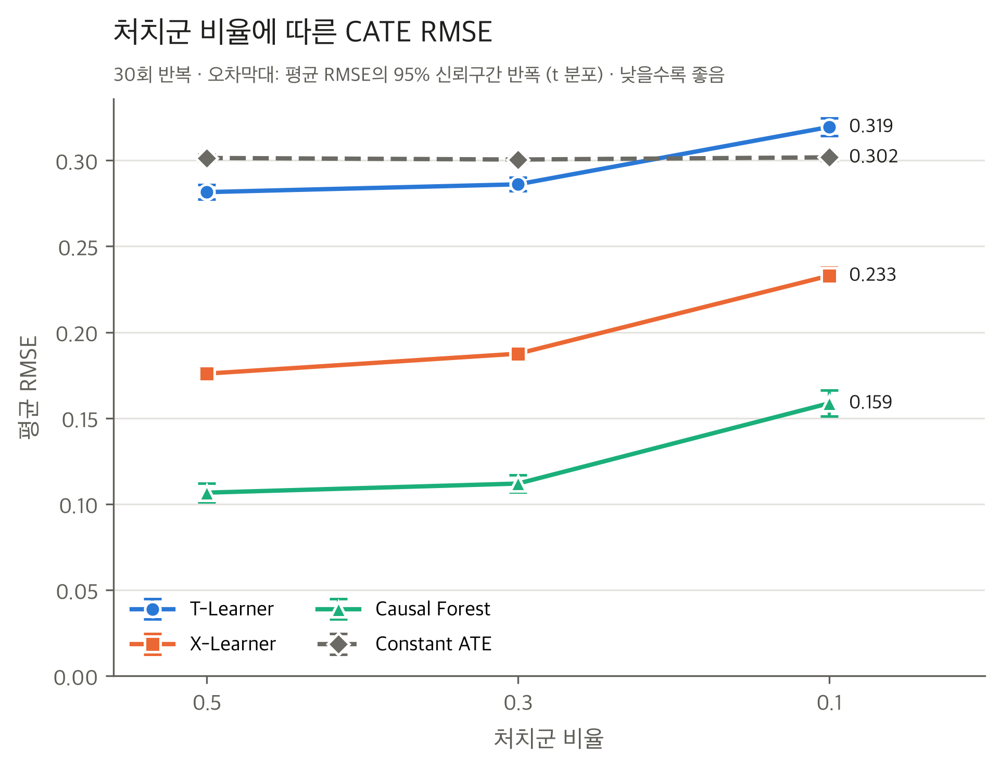
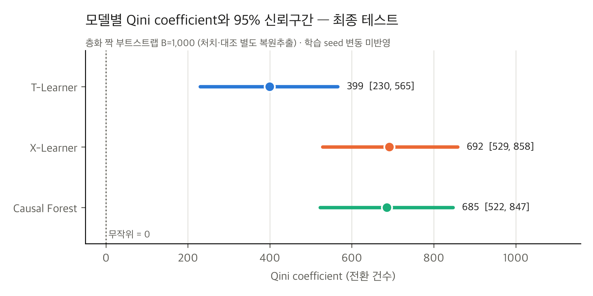

# 데이터 특성에 따른 CATE 추정 모델의 성능 비교 연구

> **교내 소프트웨어융합학술대회 발표**를 위한 팀 연구 프로젝트입니다(학술 논문 작성 목적 아님).
> 시뮬레이션(정답을 아는 데이터)과 실제 광고 데이터(Criteo Uplift v2.1)에서 T-Learner, X-Learner, Causal Forest를 비교했습니다. 각 실험 **안에서는** 세 모델에 같은 데이터·분할·모델 설정을 적용했으며, 두 실험은 데이터와 평가 지표(시뮬레이션 RMSE, Criteo Qini·AUUC)가 서로 다릅니다.

| 단계 | 내용 | 상태 |
|---|---|---|
| STEP 1~3 | 합성 데이터 생성, 모델 구현, 반복 실험 자동화 | 완료 |
| STEP 4 | 시뮬레이션 7개 조건 × 30회 반복(210회), 그래프 5종·결과표 6종 | 완료 |
| STEP 5 | Criteo v2.1 확보·EDA → 분할 → 100k 파일럿 → 300k 학습 → 검증 부트스트랩 → **최종 테스트 1회 평가** | 완료 |
| STEP 6 | 전체 결과 검증·통합(36개 점검 통과), 최종 결론·한계 정리 | 완료 |
| 테스트 | `pytest` **112개 통과** | 완료 |
| — | 발표 PPT 제작 | 예정 |

## 목차

1. [연구 목적과 연구 질문](#1-연구-목적과-연구-질문)
2. [CATE와 비교 모델](#2-cate와-비교-모델)
3. [전체 연구 진행 과정](#3-전체-연구-진행-과정)
4. [시뮬레이션 실험](#4-시뮬레이션-실험)
5. [실제 데이터 실험: Criteo v2.1](#5-실제-데이터-실험-criteo-v21)
6. [시뮬레이션과 실제 데이터 결과 비교](#6-시뮬레이션과-실제-데이터-결과-비교)
7. [최종 결론](#7-최종-결론)
8. [연구의 한계](#8-연구의-한계)
9. [주요 결과표와 그래프](#9-주요-결과표와-그래프)
10. [실험 재현 방법](#10-실험-재현-방법)
11. [프로젝트 구조](#11-프로젝트-구조)
12. [현재 상태와 향후 계획](#12-현재-상태와-향후-계획)

---

## 1. 연구 목적과 연구 질문

광고·쿠폰처럼 "누구에게 개입할지"를 정해야 하는 문제에서는, 평균 효과보다 **고객마다 다른 효과**를 아는 것이 중요합니다. 이 연구는 대표적인 CATE 추정 모델 세 가지의 성능이 **데이터 특성에 따라 어떻게 달라지는지** 비교합니다.

| 질문 | 내용 | 검증 방법 |
|---|---|---|
| Q1 | 표본 크기가 커지면 모델별 CATE 추정 정확도는 어떻게 변하는가? | 시뮬레이션 |
| Q2 | 처치군 비율이 줄면 모델별 성능은 어떻게 달라지는가? | 시뮬레이션 |
| Q3 | 처치효과가 선형·비선형·상호작용일 때 어떤 모델이 적합한가? | 시뮬레이션 |
| Q4 | 실제 광고 데이터에서도 세 모델 간 성능 차이가 나타나는가? | Criteo |
| Q5 | 실제 데이터에서 효과가 큰 고객을 선별하는 데 어떤 모델이 유리한가? | Criteo |

**두 단계로 설계한 이유**: 실제 데이터에는 고객별 정답 효과가 없어 정확도를 직접 잴 수 없습니다. 그래서 정답을 아는 시뮬레이션에서 **정확도(RMSE)** 를 비교하고, 실제 데이터에서는 정답 없이 쓸 수 있는 **타기팅 성과(Qini·AUUC)** 로 실용적인 성능을 확인했습니다.

> ⚠️ 두 실험의 척도는 다릅니다. 시뮬레이션 RMSE는 낮을수록 좋고, Criteo Qini는 높을수록 좋습니다. 두 수치를 같은 성능 점수로 비교하지 않습니다.

## 2. CATE와 비교 모델

**CATE**(조건부 평균 처치효과): $\tau(x)=E[\,Y(1)-Y(0)\mid X=x\,]$. 특성 $x$를 가진 고객에게 처치(예: 광고)를 했을 때의 평균 효과입니다. 전체 평균 효과(ATE)와 달리 고객별 효과 차이(이질성)를 추정하므로, uplift 타기팅·개인별 치료 효과·정책 대상 선정에 쓰입니다.

| 모델 | 방식 | 선정 이유 |
|---|---|---|
| **T-Learner** | 처치군·대조군 결과 모델을 따로 학습하고 예측 차이 $\hat\mu_1(x)-\hat\mu_0(x)$를 사용 | 가장 단순한 기준 메타러너 |
| **X-Learner** | T-Learner 결과로 고객별 대리 효과를 만들어 다시 학습한 뒤 성향점수로 가중 결합 | 처치·대조 집단 크기가 불균형할 때를 위해 제안(Künzel et al., 2019) |
| **Causal Forest** | 효과 이질성을 직접 분할 기준으로 쓰는 포레스트, 교차적합·honest 추정(`econml.dml.CausalForestDML`) | 대표적인 이질적 효과 추정 포레스트(Wager & Athey, 2018; Athey et al., 2019) |
| Constant ATE (기준선) | 학습 데이터의 평균 효과를 모든 고객에게 똑같이 예측 | 이질성 학습의 이득을 확인하는 비교 대상 |

공정한 비교를 위해 각 실험 안에서 세 모델에 같은 조건(같은 데이터·분할·seed 규칙과 아래 설정)을 적용했습니다. 모델 구현과 하이퍼파라미터는 두 실험에서 같고, 데이터와 평가 지표는 실험마다 다릅니다.
- 기본 학습기: RandomForest 200그루, `min_samples_leaf=5`, `max_features=1.0`
- Causal Forest: 1,000그루, `cv=5`, honest, 처치 모델은 상수 성향점수
- 하이퍼파라미터는 실험 전에 고정했고, 조건별 튜닝은 하지 않았습니다.
- 모델 입력은 X, T, Y뿐이며, 정답 CATE는 채점에만 썼습니다(누수 방지를 테스트로 확인).

## 3. 전체 연구 진행 과정

```text
① 문제 정의 → ② 시뮬레이션 설계(7개 조건, OFAT) → ③ 30회 반복 실험(210회) → ④ RMSE·통계 검정
→ ⑤ Criteo v2.1 확보·EDA → ⑥ 비례 층화 분할(테스트 20% 먼저 고정) → ⑦ 100k 파일럿
→ ⑧ 300k 학습(메모리 실측으로 규모 결정) → ⑨ 검증 세트 짝 부트스트랩 → ⑩ 설정 고정(SHA-256) → ⑪ 최종 테스트 1회
→ ⑫ 결과 검증·통합(STEP 6)
```

단계별 상세 설명과 설계 이유는 [docs/step6_1_research_overview.md](docs/step6_1_research_overview.md)를 보세요.

## 4. 시뮬레이션 실험

### 4-1. 데이터 생성 (`src/data_generation.py`)

$$
X_1,\dots,X_{10}\overset{iid}{\sim}N(0,1),\quad T\sim\text{Bernoulli}(p),\quad Y=\mu_0(X)+T\,\tau(X)+\varepsilon,\quad \varepsilon\sim N(0,1)
$$

- $\mu_0(X)=0.2X_1-0.1X_2+0.3X_3$이고, $X_4$~$X_{10}$은 결과와 무관한 잡음 변수입니다.
- 처치는 X와 독립인 무작위 배정이라, 교란 요인이 없습니다.
- **정답 CATE**: $\tau(X)=0.5+0.3\,g(X)$. $g$는 평균 0, 분산 1로 맞췄습니다. 그래서 세 효과 구조 모두 **평균 효과 0.5, 이질성 SD 0.3이 같고 함수 모양만** 다릅니다.

| 효과 구조 | $g(X)$ | 특징 |
|---|---|---|
| linear | $X_1$ | 기준 |
| nonlinear | $\frac{1}{\sqrt2}\left[\frac{X_1^2-1}{\sqrt2}+\frac{\sin(\pi X_2)}{s}\right]$ | U자형 + 주기형, 선형 설명력 ≈ 0 |
| interaction | $X_1X_2$ | 주효과 없는 순수 상호작용 |

비선형 함수의 정규화 상수는 $s=\sqrt{(1-e^{-2\pi^2})/2}\approx0.7071$입니다(`src/data_generation.py`의 `_SIN_PI_SD`). 이는 $Z\sim N(0,1)$일 때 $\sin(\pi Z)$의 표준편차($E[\sin^2(\pi Z)]=\tfrac12(1-e^{-2\pi^2})$)로, 두 항을 각각 평균 0·분산 1로 맞춘 뒤 $\sqrt2$로 나누어 $g$의 분산을 1로 만듭니다.

### 4-2. 실험 설계: OFAT 7개 조건 × 30회

| 조건 | n | 처치군 비율 p | 효과 구조 | 바뀐 요인 |
|---|---|---|---|---|
| c00 | 1,000 | 0.5 | linear | 표본 크기 |
| **c01 (기준)** | 10,000 | 0.5 | linear | — |
| c02 | 100,000 | 0.5 | linear | 표본 크기 |
| c03 | 10,000 | 0.3 | linear | 처치 비율 |
| c04 | 10,000 | 0.1 | linear | 처치 비율 |
| c05 | 10,000 | 0.5 | nonlinear | 효과 구조 |
| c06 | 10,000 | 0.5 | interaction | 효과 구조 |

- **반복**: 조건별 30회, 총 210회(`formal_runs.csv` 840행). 반복 r의 데이터 seed는 42 + r, 모델 seed는 1000 + r입니다.
- **분할**: 같은 반복에서는 모든 모델이 **같은 데이터와 같은 80/20 분할**(T로 층화)을 씁니다. 그래서 모델끼리 짝비교를 할 수 있습니다.
- **지표**: 테스트 세트에서 정답 CATE 대비 RMSE(주 지표)와 MAE, 반복 간 SD(안정성)를 계산했습니다.
- **통계**: 반복 평균의 95% CI, 같은 반복끼리의 짝 t검정 + 조건 내 Holm 보정, 조건 간 짝비교 + 비교 묶음별 Holm 보정을 썼습니다.

### 4-3. 결과: 조건별 RMSE 평균 ± SD (30회)

| 조건 | T-Learner | X-Learner | Causal Forest | Constant ATE |
|---|---|---|---|---|
| n=1k | 0.3798 ± 0.0374 | 0.2757 ± 0.0445 | **0.2091 ± 0.0336** | 0.3085 ± 0.0189 |
| n=10k (기준) | 0.2816 ± 0.0112 | 0.1759 ± 0.0096 | **0.1067 ± 0.0144** | 0.3014 ± 0.0051 |
| n=100k | 0.2211 ± 0.0032 | 0.1230 ± 0.0028 | **0.0621 ± 0.0035** | 0.2998 ± 0.0018 |
| p=0.3 | 0.2861 ± 0.0105 | 0.1875 ± 0.0097 | **0.1119 ± 0.0134** | 0.3005 ± 0.0048 |
| p=0.1 | 0.3195 ± 0.0136 | 0.2329 ± 0.0126 | **0.1587 ± 0.0203** | 0.3018 ± 0.0053 |
| nonlinear | 0.3029 ± 0.0123 | **0.2034 ± 0.0098**† | 0.2089 ± 0.0180 | 0.3013 ± 0.0066 |
| interaction | 0.2916 ± 0.0146 | **0.2171 ± 0.0172** | 0.2422 ± 0.0144 | 0.3021 ± 0.0096 |

굵은 글씨는 평균 RMSE가 가장 낮은 모델입니다. † 비선형 조건의 X−CF 차이는 **통계적으로 유의하지 않습니다**. 95% CI와 MAE는 [통합 결과 Table 2](docs/step6_1_integrated_results.md)에 있습니다.

### 4-4. 핵심 발견과 통계 검정

| 요인 | 핵심 발견 | 근거 (짝비교, Holm 보정) |
|---|---|---|
| **표본 크기** | 세 모델 모두 정확해지고, Causal Forest가 가장 크게 개선 | 1k → 100k: T −41.8%, X −55.4%, **CF −70.3%**. 9개 비교 모두 유의(p_holm ≤ 9.1e-12), 30/30회 감소. Constant ATE는 유의한 변화 없음 |
| **처치군 비율** | 10%로 줄면 모두 악화. T-Learner는 단순 기준선보다도 나빠짐 | 0.5 → 0.1: T +13.5%, X +32.4%, CF +48.8%(모두 유의). p=0.1에서 T − Constant ATE = +0.018 [0.012, 0.023], 유의. 30회 중 T-Learner의 RMSE가 더 낮았던 반복은 3회, Constant ATE가 더 낮았던 반복은 27회. n=1k에서도 T가 기준선보다 나쁨(+0.071, 30회 모두 Constant ATE의 RMSE가 더 낮음). 0.5 → 0.3은 X만 유의 |
| **효과 구조: 선형** | Causal Forest가 가장 정확 | 선형 5개 조건(c00~c04) 모두에서 CF < X 유의(p_holm < 0.001) |
| **효과 구조: 상호작용** | X-Learner가 RMSE 기준으로 더 정확 | X − CF = −0.0251 [−0.0286, −0.0216], p_holm < 0.001, X 우세 30/30 |
| **효과 구조: 비선형** | X와 CF 차이가 **확인되지 않음** | X − CF = −0.0056 [−0.0112, 0.0001], **p_holm = 0.106** |
| **복잡성 민감도** | CF는 효과 구조가 복잡해질 때 오차가 가장 크게 증가 | 선형 대비 CF +95.9%(비선형), +127.1%(상호작용) / X +15.6%, +23.4% / T +7.6%, +3.6% |

- **보조 분석**(STEP 6에서 기존 반복 결과를 다시 분석, 사전 계획 아님): 상호작용 조건의 X 우위는 **MAE에서는 나타나지 않았습니다**(X − CF = −0.0002, p = 0.87). 따라서 상호작용 결론은 RMSE 기준으로 한정합니다.
- **안정성**: 표본이 커질수록 모든 모델의 반복 간 SD가 줄었습니다(CF 0.034 → 0.004). n=10k의 대부분 조건에서는 CF의 SD가 X보다 컸습니다.
- **계산 시간**: n=10k 평균 학습 시간은 T 3.3초, X 7.2초, CF 33.6초입니다. n=100k 반복 1회는 약 741초입니다.

## 5. 실제 데이터 실험: Criteo v2.1

### 5-1. 데이터 출처와 변수

| 항목 | 내용 |
|---|---|
| 데이터 | Criteo Uplift Prediction Dataset **v2.1** (erratum 반영 un-biased 수정판, 원래 2,530만 행 버전 아님) |
| 출처 | Criteo AI Lab, <https://ailab.criteo.com/criteo-uplift-prediction-dataset/>. 공식 페이지 링크가 끊겨 있어(2026-11 확인) Criteo AI Lab의 Hugging Face 저장소에서 받음. SHA-256 `2716e1bf…f616dc` |
| 라이선스 | CC BY-NC-SA 4.0 (비영리). **원본 데이터는 저장소에 포함하지 않음** |
| 인용 | Diemert, E., Betlei, A., Renaudin, C., & Amini, M.-R. (2018). *A Large Scale Benchmark for Uplift Modeling*. AdKDD & TargetAd Workshop, KDD |
| 규모 | 13,979,592행, 결측·무한대 없음 |
| X | `f0`~`f11` (익명화된 특성 12개) |
| T | `treatment` = 캠페인 **배정** (처치 85.0% / 대조 15.0%) |
| Y | `conversion` (전환율 0.292%. 처치 0.309%, 대조 0.194%. 대조군 전환은 전체 4,063건) |
| 사용 안 함 | `visit`, `exposure`: 배정 이후 변수라 X나 T로 쓰지 않음. 추정 대상은 **ITT 효과** |

### 5-2. 분할과 학습 과정

- **분할**: 원본 파일이 treatment별 연속 구간으로 정렬되어 있어서, 앞부분만 잘라 쓰면 편향된 표본이 됩니다. 그래서 treatment × conversion 4개 층 **비례 층화 무작위 분할**(seed 42)을 했습니다.
  - **최종 테스트 20%(2,795,918행)를 먼저 고정**하고, 이어서 검증 20%, 학습 풀 60%로 나눴습니다.
  - 학습 후보는 100k ⊂ 300k ⊂ 1M 중첩 표본입니다.
  - 전환 사례 과대표집은 하지 않았습니다.
  - **원본 행 인덱스 기준 중복**: 각 분할 안의 행 번호 중복과 테스트·검증·학습 간 교집합은 모두 0이며, 세 분할을 합치면 전체 13,979,592행과 정확히 같습니다.
  - **특성값 기준 중복**은 이와 별개입니다: 원본에는 f0~f11 값이 완전히 같은 행의 추가 사본이 1,626,259건(11.6%) 있습니다(16개 열 전체가 같은 행은 1,259,545건, 9.0%). 사용자 ID가 없어 같은 사용자인지 판단할 수 없으므로 제거하지 않았고, 이런 행은 서로 다른 분할에 나뉘어 있을 수 있습니다.
  - 클래스 불균형(처치 85:15, 전환율 0.29%)에 대해서는 **비례 층화 분할 외에 학습 단계의 추가 보정(클래스 가중치, 과대·과소표집 등)을 적용하지 않았습니다**. 평가 지표가 처치·대조 집단별 분모를 쓰는 것은 별도의 평가 정의입니다.
- **설정**: STEP 4와 같은 모델 구현·하이퍼파라미터·seed(42)를 썼습니다(`configs/criteo_models.yaml`). 이진 Y에서도 회귀 결과 모델(확률 추정)이 유효함을 공식 API 기준으로 검토했습니다.

| 학습 규모 | 학습 대조군 전환 | 학습 시간 T / X / CF | 최대 메모리 T / X / CF | 비고 |
|---|---|---|---|---|
| 100k 파일럿 | 29건 | 16.7 / 51.1 / 201.2초 | 1.0 / 1.1 / 2.4 GB | T 예측의 84.8%가 정확히 0 |
| **300k (최종)** | 87건 | 60.3 / 176.6 / 726.1초 | 1.0 / 1.4 / 3.8 GB | CF 포레스트 크기가 표본에 비례(×3.0) → 1M은 7 GB 보호 기준 초과로 판단 |

**300k로 확정한 이유**: 세 모델이 같은 설정으로 메모리 기준(7 GB, 16 GB Mac) 안에서 돌아가는 가장 큰 규모입니다.

### 5-3. 평가 방법

정답 CATE가 없으므로 **RMSE는 계산하지 않았습니다.** 테스트 고객을 모델의 예측 효과 내림차순으로 정렬한 뒤, 상위 $k$명(비율 $\phi$)의 처치군·대조군 인원 $N_t, N_c$와 전환 수 $Y_t, Y_c$로 평가합니다.

| 지표 | 정의 | 단위 |
|---|---|---|
| Uplift curve $U(k)$ | $\left(\frac{Y_t}{N_t}-\frac{Y_c}{N_c}\right)\cdot k$: 상위 $k$명 전원 처치 시 증분 전환 | 건 |
| Qini curve $Q(k)$ | $Y_t - Y_c\,\frac{N_t}{N_c}$: 대조군을 처치군 규모로 환산해 85:15 불균형 보정 | 건 |
| AUUC | $\int_0^1 U\,d\phi$ (101점 격자 사다리꼴 적분) | 건 |
| **Qini coefficient (주 지표)** | Qini 곡선 면적 − 무작위 직선 면적 $Q(N)/2$ (무작위 = 0) | 건 |
| 정규화 AUUC (보조) | $(\text{AUUC}-U(N)/2)/U(N)$, $U(N)\le0$이면 정의하지 않음 | 무단위 |
| 상위 10/20/30% 증분 전환 | (처치군 전환율 − 대조군 전환율) × 타기팅 인원 | 건 |

- **동점 점수**: 블록 단위로 선형 보간합니다(무작위 순서의 기댓값).
- **불확실성**: 처치·대조 **층화 짝 부트스트랩** B=1,000(seed 42). 세 모델에 같은 재표본을 적용합니다.
- **판정 기준**: 무작위보다 우수 = Qini 95% CI > 0. 모델 간 차이 = 3쌍 Bonferroni 98.33% CI가 0을 제외.
- **검증**: 평가 코드는 단위 테스트 16개로 확인했습니다.

### 5-4. 최종 테스트 결과 (2,795,918명, 1회 평가)

테스트 전에 모델·설정·분할 파일의 SHA-256을 확인했고, 학습·검증과 겹치는 행이 0임을 확인했습니다. 재학습이나 재튜닝은 하지 않았습니다.

| 모델 | **Qini coefficient [95% CI]** | AUUC [95% CI] | 정규화 AUUC | 무작위 대비 |
|---|---|---|---|---|
| T-Learner | 399.2 [229.9, 565.3] | 2,073.6 [1,734.4, 2,388.4] | 0.144 | 우수 |
| X-Learner | **691.7** [528.5, 858.0] | 2,415.4 [2,073.1, 2,747.2] | 0.251 | 우수 |
| Causal Forest | 685.4 [522.3, 846.6] | 2,407.8 [2,066.7, 2,737.7] | 0.248 | 우수 |
| 무작위 타기팅 | 0 | 1,608.8 | 0 | — |

**모델 간 짝비교 (Qini coefficient, Bonferroni 3쌍)**

| 비교 | 차이 | 95% CI | Bonferroni 98.3% CI | 판정 |
|---|---|---|---|---|
| X-Learner − T-Learner | +292.5 | [145.5, 441.0] | [106.5, 464.0] | **유의** |
| Causal Forest − T-Learner | +286.2 | [129.1, 435.4] | [97.0, 472.2] | **유의** |
| Causal Forest − X-Learner | −6.3 | [−147.5, 126.1] | [−176.2, 157.2] | 유의하지 않음 |

**상위 타기팅 비율별 추정 증분 전환 (건, 95% CI)**

| 타기팅 | T-Learner | X-Learner | Causal Forest | 무작위 |
|---|---|---|---|---|
| 상위 10% (279,592명) | 1,677 [1,322, 2,012] | 1,905 [1,572, 2,243] | 1,934 [1,586, 2,277] | 322 [276, 359] |
| 상위 20% (559,184명) | 1,912 [1,563, 2,232] | 2,265 [1,913, 2,609] | 2,310 [1,947, 2,648] | 644 [552, 719] |
| 상위 30% (838,775명) | 2,016 [1,669, 2,338] | 2,462 [2,111, 2,810] | 2,446 [2,093, 2,787] | 965 [828, 1,078] |

- 상위 10%만 타기팅해도 무작위의 **약 5~6배**입니다. 이는 전체 처치 시 증분 전환(3,218건)의 52~60%에 해당합니다.
- 상위 10%에서는 모델 간 차이가 Bonferroni 보정 후 **유의하지 않습니다**(CF − T [−1, 503], X − T [−45, 476]).
- 상위 20·30%에서는 X·CF > T가 보정 후에도 유의합니다(2차 지표).
- T-Learner는 테스트 예측의 **83.6%가 정확히 0**이었습니다(양수 11.2%, 음수 5.3%, 저장된 테스트 예측 2,795,918개 기준). 따라서 내림차순 순위에서 양수 예측 상위 약 11.2% 다음에는 83.6%의 동점(0) 블록이 이어지며, 이 블록 안에서는 고객 순위를 구분하지 못합니다(평가에서는 동점 블록을 무작위 순서의 기댓값으로 처리).

**검증 세트 vs 테스트 (같은 고정 모델)**

| Qini 비교 | 검증: 차이 [Bonferroni CI] | 테스트: 차이 [Bonferroni CI] |
|---|---|---|
| CF − T | +252 [79, 426] | +286 [97, 472] → 두 데이터 모두 유의 |
| X − T | +105 [−71, 286] | +292 [107, 464] → 테스트에서만 유의 |
| CF − X | +147 [−8, 312] | −6 [−176, 157] → 둘 다 비유의, 부호 반전 |

검증 세트에서 CF가 X보다 수치상 앞섰던 결과는 테스트에서 재현되지 않았습니다. 처음부터 보정 후 유의하지 않았던 차이입니다. 100k → 300k 개선(검증 세트)은 CF만 0을 제외했습니다(+272 [96, 445]).

## 6. 시뮬레이션과 실제 데이터 결과 비교

두 실험은 평가 목적이 다릅니다. RMSE는 **효과 크기의 정확도**, Qini는 **효과 순위에 따른 타기팅 성과**를 봅니다. 또 Criteo는 하나의 관측 환경이므로 시뮬레이션의 특정 조건과 일대일로 대응시키지 않습니다.

| 구분 | 시뮬레이션 | 실제 Criteo | 관계 |
|---|---|---|---|
| T-Learner | 7개 조건 모두 RMSE 최대. n=1k·p=0.1에서는 Constant ATE보다도 나쁨 | Qini 최저(X·CF 대비 유의). 예측의 83.6%가 0 | **공통**: 본 연구 조건에서 한 집단의 정보가 부족할 때 가장 취약 |
| 학습 데이터 증가 | 세 모델 모두 유의하게 개선, CF 최대(−70.3%) | 100k → 300k에서 개선, 0을 제외한 것은 CF만(검증) | **같은 방향** |
| X vs CF | 선형은 CF 우세, 상호작용은 X 우세(RMSE), 비선형은 구분 불가 | 구분 불가(−6.3, 비유의) | **조건에 따라 다름** |
| 불균형 방향 | 처치군이 적은 경우(10%) | 대조군이 적은 경우(15%) | 직접 대응 불가 |

## 7. 최종 결론

> **본 연구에서 검증한 조건(시뮬레이션 7개 조건, Criteo v2.1 300k 학습·고정 하이퍼파라미터)에서 CATE 모델의 성능은 데이터 특성에 따라 체계적으로 달라졌으며, 하나의 모델이 모든 조건에서 최선은 아니었습니다. 가장 일관된 결과는 T-Learner의 열세이고, X-Learner와 Causal Forest의 우열은 조건에 따라 달랐습니다.**

| 항목 | 결론 | 근거 |
|---|---|---|
| ① 표본 크기 | 검증한 범위(n=1k~100k, p=0.5, 선형)에서 표본이 클수록 세 모델 모두 정확해지며, 데이터 증가의 이득은 Causal Forest가 가장 큼 | 1k → 100k RMSE: T −41.8%, X −55.4%, CF −70.3%, 모두 유의 |
| ② 처치군 불균형 | 검증한 조건(n=10k, 선형)에서 처치군이 10%로 줄면 모든 모델의 정확도가 떨어지며, T-Learner가 가장 취약 | p=0.1에서 세 모델 모두 유의하게 악화. T는 Constant ATE보다도 나쁨(+0.018, 유의) |
| ③ 효과 구조 | 최적 모델은 효과 구조에 따라 달라짐: 선형은 CF, 상호작용은 X(RMSE 기준), 비선형은 우열 불명 | 선형 5개 조건 CF 유의 우세. 상호작용 X 유의 우세(30/30). 비선형 p_holm = 0.106 |
| ④ 실제 Criteo | 세 모델 모두 무작위 타기팅보다 우수. X와 CF는 T보다 유의하게 우수하나 둘 간 차이는 확인되지 않음 | Qini T 399 / X 692 / CF 685. X−T, CF−T는 Bonferroni 유의, CF−X는 비유의. 상위 10% 증분 전환은 무작위의 약 5~6배 |
| ⑤ 종합 | 본 연구와 유사한 불균형·희귀 전환 조건에서는 T-Learner보다 X-Learner나 Causal Forest를 우선 고려할 수 있음. 둘 중 선택은 효과 구조와 계산 비용을 함께 고려해야 함 | 300k 학습: X 177초 / 1.4 GB, CF 726초 / 3.8 GB |

**발표용 결론 3문장**

1. 본 연구에서 검증한 조건에서 CATE 모델의 성능은 표본 크기, 처치군 비율, 효과 구조에 따라 체계적으로 달라졌으며, 하나의 모델이 모든 조건에서 최선은 아니었습니다.
2. 시뮬레이션과 실제 광고 데이터 모두에서 T-Learner가 가장 약했고, X-Learner와 Causal Forest가 더 정확하거나 더 나은 타기팅 성과를 보였습니다.
3. 실제 데이터에서 예측 상위 10% 고객 타기팅은 무작위 대비 약 5~6배의 증분 전환을 보여, 이 데이터에서는 데이터 특성에 맞는 CATE 모델 선택이 효율적인 타기팅의 출발점이 될 수 있음을 확인했습니다.

**이 연구의 기여**: 새로운 알고리즘을 제안한 것이 아니라, 기존 대표 모델 세 가지를 **통제된 시뮬레이션(210회 반복, RMSE 평가)과 실제 대규모 광고 데이터(Qini·AUUC 평가)** 에서, 각 실험 안에서는 같은 데이터·분할·설정으로 비교했습니다. 그리고 통계적 불확실성(짝비교·다중검정 보정·층화 부트스트랩)과 함께 보고했습니다.

상세 결론과 발표용 5문장 버전: [docs/step6_2_final_conclusions.md](docs/step6_2_final_conclusions.md)

## 8. 연구의 한계

| 구분 | 한계 |
|---|---|
| 시뮬레이션 | 데이터 생성 구조가 하나뿐(정규 공변량, 무작위 배정, 고정 잡음, 구조별 효과 함수 하나) |
| 시뮬레이션 | OFAT 설계라 요인 간 교호작용(예: 작은 n × 불균형)은 검증하지 않음 |
| 시뮬레이션 | 효과 구조별 평균·SD는 같지만 분포 모양(왜도·꼬리)은 다름 |
| 시뮬레이션 | 결론은 RMSE 기준. 상호작용 조건의 X 우위는 MAE에서는 나타나지 않음 |
| 공통 | 하이퍼파라미터를 고정해 튜닝하지 않음. "각 모델의 최고 성능" 비교가 아님 |
| Criteo | 모델당 학습 seed 1개. 부트스트랩은 테스트 표본 변동만 반영 |
| Criteo | 전환율 0.29%로 매우 낮고 처치 85% / 대조 15%로 불균형 → 대조군 쪽 학습 정보 부족 |
| Criteo | T-Learner 예측의 83.6%가 동점(0) |
| Criteo | 1,100만 행 중 300k만 학습(16 GB 메모리 제약) |
| Criteo | 추정 대상은 **캠페인 배정 효과(ITT)**. 실제 노출은 처치군의 3.6%라 노출 효과로 해석할 수 없음 |
| Criteo | 학습 규모(300k)는 검증 세트 결과를 참고해 결정. 테스트는 그 후 1회만 사용 |
| Criteo | 원본 행 인덱스 중복·분할 간 교집합은 0이지만, 특성값이 완전히 같은 행(추가 사본 11.6%)은 사용자 ID가 없어 제거하지 않았으므로 분할 간에 나뉘어 있을 수 있음 |
| 연결 | 시뮬레이션 RMSE(효과 크기 정확도)와 Criteo Qini(순위 기반 타기팅 성과)는 평가 목적이 다름 |

전체 한계와 대응: [docs/step6_2_limitations.md](docs/step6_2_limitations.md)

## 9. 주요 결과표와 그래프

### 발표용 핵심 그래프 ([results/figures/step6_final/](results/figures/step6_final/), PNG 300 dpi + PDF)

| | 시뮬레이션 (RMSE, 낮을수록 좋음) | 실제 Criteo (타기팅 성과, 높을수록 좋음) |
|---|---|---|
| 1 |  표본 크기별 RMSE |  최종 테스트 Qini curve |
| 2 |  처치군 비율별 RMSE |  Qini coefficient와 95% CI |
| 3 |  효과 구조별 RMSE |  상위 10/20/30% 증분 전환 |

그래프별 실험 조건, 축 의미, 통계적 주의점: [docs/step6_2_presentation_key_messages.md](docs/step6_2_presentation_key_messages.md)

### 결과 파일

| 구분 | 경로 |
|---|---|
| STEP 6 통합 요약 | `results/tables/step6_final_simulation_summary.csv`, `step6_final_criteo_summary.csv`, `step6_simulation_key_tests.csv`, `step6_criteo_key_tests.csv`, `step6_verification_checks.csv` |
| 시뮬레이션 원자료·요약 | `results/tables/formal_runs.csv`(840행), `formal_summary.csv`, `formal_paired.csv`, `formal_{sample_size,treat_ratio,complexity}_comparison.csv` |
| 시뮬레이션 그래프·표 | [results/figures/final_step4/](results/figures/final_step4/) (그래프 5종), [results/figures/final_step4/tables/](results/figures/final_step4/tables/) (결과표 6종) |
| Criteo EDA·분할 | `results/tables/criteo_eda_summary.csv`, `criteo_split_summary.csv` 외, [results/figures/criteo_eda/](results/figures/criteo_eda/) |
| Criteo 100k·300k (검증) | `results/tables/criteo_pilot_100k_*.csv`, `criteo_300k_*.csv`, `criteo_100k_vs_300k.csv`, `criteo_300k_bootstrap_summary.csv`, `criteo_300k_paired_comparison.csv` |
| **Criteo 최종 테스트** | `results/tables/criteo_final_test_{metrics,bootstrap,paired,targeting}.csv`, `criteo_final_test_metadata.json`, [results/figures/criteo_final_test/](results/figures/criteo_final_test/) |

### 문서

| 문서 | 내용 |
|---|---|
| [docs/step6_1_research_overview.md](docs/step6_1_research_overview.md) | 전체 연구 과정과 설계 이유 |
| [docs/step6_1_integrated_results.md](docs/step6_1_integrated_results.md) | 검증된 통합 결과, Table 1~6 (발표용 간결판 / 검증용 상세판) |
| [docs/step6_1_result_interpretation.md](docs/step6_1_result_interpretation.md) | 연구 질문 Q1~Q5별 해석 |
| [docs/step6_2_final_conclusions.md](docs/step6_2_final_conclusions.md) | 최종 결론(상세 / 5문장 / 3문장), 연구 기여 |
| [docs/step6_2_limitations.md](docs/step6_2_limitations.md) | 연구의 한계와 표현 원칙 |
| [docs/step6_2_presentation_key_messages.md](docs/step6_2_presentation_key_messages.md) | 발표용 그래프 설명과 핵심 메시지 |
| `docs/criteo_step5_1_report.md` ~ `criteo_step5_6_final_report.md` | Criteo 단계별 상세 보고서 |

## 10. 실험 재현 방법

### 환경

Python 3.11 이상이 필요합니다(실행 환경: Python 3.13.9, macOS arm64, Apple M5, RAM 16 GB).

```bash
python3 -m venv .venv
source .venv/bin/activate          # Windows PowerShell: .venv\Scripts\Activate.ps1
pip install -r requirements.txt
pytest                             # 112개 테스트
```

사용 버전: numpy 2.5.4, pandas 2.3.3, scikit-learn 1.9.1, econml 0.17.0, scipy 1.18.1.

### 시뮬레이션 (STEP 4)

```bash
python scripts/run_simulation.py --tag formal --list-conditions        # 조건과 완료 반복 수 확인 (파일 변경 없음)
python scripts/run_simulation.py --tag repro --condition-id c00        # 새 tag로 재현 (기존 formal 결과 보존)
python scripts/run_simulation.py --tag repro --condition-id c01 c03 --resume
python scripts/memory_guard.py --limit-mb 7000 --interval 5 --log results/tables/repro_c02_memory.csv -- \
  python scripts/run_simulation.py --tag repro --condition-id c02 --resume --max-new-reps 5   # n=100k를 5회씩
python results/figures/final_step4/make_final_plots.py                 # 그래프 5종 (저장된 CSV만 사용)
python results/figures/final_step4/tables/make_final_tables.py         # 결과표 6종
```

- 주요 옵션: `--condition-id`(조건 선택), `--resume`(완료 반복 건너뜀, 무결성 검사), `--max-new-reps K`(K회씩 나누어 실행), `--overwrite`(선택 밖 조건이 있으면 거부).
- 같은 tag의 결과가 있으면 `--resume`이나 `--overwrite` 없이는 실행되지 않습니다.
- 실측 시간(단일 스레드): 반복 1회당 n=1k 약 3초, n=10k 약 44~48초, n=100k 약 741초. 210회 전체 약 8.1시간입니다.

### Criteo (STEP 5)

원본 데이터를 `data/criteo/criteo-research-uplift-v2.1.csv.gz`에 두어야 합니다(Git 제외, SHA-256으로 확인).

```bash
python scripts/criteo_eda.py                                              # EDA (청크 처리, 약 20초)
python scripts/criteo_prepare.py                                          # 분할 인덱스 생성/검증 (기존 인덱스는 덮어쓰지 않음)
caffeinate -i python scripts/criteo_pilot.py all --train train_100000 --tag pilot_100k            # 100k 파일럿
caffeinate -i python scripts/criteo_step5_4.py run --models T X CF --train train_300000 --tag 300k  # 300k 학습
python scripts/criteo_step5_4.py compare --base pilot_100k --new 300k     # 100k vs 300k (검증)
caffeinate -i python scripts/criteo_bootstrap.py --n-boot 1000 --seed 42  # 검증 세트 짝 부트스트랩
caffeinate -i python scripts/criteo_final_test.py --split test            # 최종 테스트 (결과가 있으면 재실행 거부)
python scripts/step6_summarize.py                                         # STEP 6 결과 검증·통합
```

- 각 스크립트는 기존 결과 파일이 있으면 덮어쓰지 않고 중단합니다.
- 300k Causal Forest는 학습 약 12분, 검증 예측 약 5분, 최대 메모리 3.8 GB입니다.
- 최종 테스트 평가는 전체 628초, 최대 메모리 3.1 GB입니다.

## 11. 프로젝트 구조

```text
cate-benchmark/
├── src/
│   ├── data_generation.py     # 시뮬레이션 DGP, 효과 함수
│   ├── models.py              # T-Learner, X-Learner, CausalForestDML 래퍼 (STEP 4·5 공통)
│   ├── evaluation.py          # 시뮬레이션 분할·RMSE/MAE·Constant ATE
│   ├── simulation.py          # OFAT 조건, 반복 실행, 요약·짝비교 통계
│   ├── criteo_data.py         # Criteo 변수 정의, 층화 분할, 청크 단위 행 로딩
│   ├── criteo_models.py       # Criteo용 모델 생성, 배치 예측, 예측 진단
│   ├── criteo_evaluation.py   # Qini/Uplift/AUUC, 상위 q% 증분 전환, 층화 짝 부트스트랩
│   └── criteo_analysis.py     # 동점 진단, 구간별 효과 분석
├── scripts/                   # 실행 진입점 (시뮬레이션·Criteo·STEP 6 검증, memory_guard)
├── configs/
│   ├── experiment.yaml        # 시뮬레이션 설계 (기준 조건, 요인, 반복 수, seed)
│   ├── models.yaml            # STEP 4 하이퍼파라미터
│   ├── criteo_models.yaml     # Criteo 설정 (STEP 4와 같은 값 + 예측 설정)
│   └── simulation.yaml
├── tests/                     # pytest 112개
├── docs/                      # STEP 5 단계별 보고서, STEP 6 통합 문서
├── data/                      # (Git 제외) 합성 데이터, Criteo 원본·분할 인덱스·모델·예측
└── results/
    ├── tables/                # formal_*, criteo_*, step6_* 결과 (Git 포함)
    └── figures/               # final_step4/, criteo_*/, step6_final/ (Git 포함)
```

**Git에 올리지 않는 항목**(`.gitignore`): Criteo 원본(311 MB), 분할 인덱스, 학습된 모델 파일(`data/criteo/models/`, 300k 모델 약 685 MB), 검증·테스트 예측, 부트스트랩 반복값, 메모리 로그, 합성 데이터.

## 12. 현재 상태와 향후 계획

| 항목 | 상태 |
|---|---|
| 시뮬레이션 7개 조건 × 30회 | 완료 |
| Criteo 100k 파일럿, 300k 학습, 검증 부트스트랩, 최종 테스트 | 완료 |
| 결과 검증·통합 (`step6_verification_checks.csv` 36/36 통과) | 완료 |
| 자동 테스트 | **pytest 112개 통과** (데이터 생성 37, 모델 15, 시뮬레이션 27, Criteo 평가 16, 분할 6, Criteo 모델 8, 분석 3) |
| 발표 PPT | 예정 |

**진행하지 않은 작업** (완료로 간주하지 않음)
- 시뮬레이션의 Spearman 순위 상관계수: 계획했으나 계산하지 않았습니다. 정식 결과에는 개체별 예측값이 저장되어 있지 않습니다.
- 27개 조건 완전요인설계: 코드는 구현했지만 실행하지 않았습니다.
- Criteo 1M 학습, 학습 seed 반복, 하이퍼파라미터 튜닝

## 참고 문헌

- Künzel, S. R., Sekhon, J. S., Bickel, P. J., & Yu, B. (2019). Metalearners for estimating heterogeneous treatment effects using machine learning. *PNAS*, 116(10), 4156–4165. https://doi.org/10.1073/pnas.1804597116
- Wager, S., & Athey, S. (2018). Estimation and inference of heterogeneous treatment effects using random forests. *Journal of the American Statistical Association*, 113(523), 1228–1242. https://doi.org/10.1080/01621459.2017.1319839
- Athey, S., Tibshirani, J., & Wager, S. (2019). Generalized random forests. *The Annals of Statistics*, 47(2), 1148–1178. https://doi.org/10.1214/18-AOS1709
- Diemert, E., Betlei, A., Renaudin, C., & Amini, M.-R. (2018). A Large Scale Benchmark for Uplift Modeling. AdKDD & TargetAd Workshop, KDD.
- Zhang, Y., Wang, Q., Zhu, X., Liu, B., & You, G. (2026). A Multi-Dimensional Benchmark of HTE Estimators for Decision Support. *2026 12th International Conference on Big Data and Information Analytics (BigDIA)*, 621–628. https://doi.org/10.1109/BigDIA71496.2026.11684620 ([IEEE Xplore](https://ieeexplore.ieee.org/abstract/document/11684620/))
  — 데이터 조건별 HTE 추정 모델 성능을 비교한 선행연구. 본 프로젝트는 이 논문의 실험 조건을 재현하지 않았습니다.
