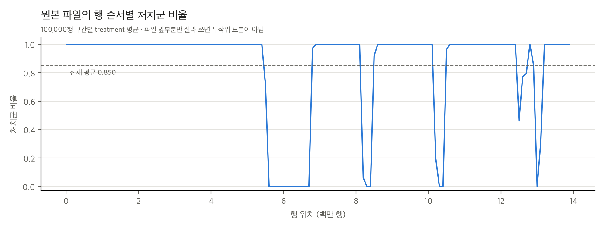

# STEP 5-1 보고서: Criteo Uplift 데이터 확보 및 EDA

- 작성일: 2026-11-11
- 범위: 데이터 확보, 구조 검증, EDA, 표본 규모 검토, 평가 설계 검토
- **모델 학습과 Qini/AUUC 평가는 수행하지 않았습니다.**
- 재현: `.venv/bin/python scripts/criteo_eda.py` (전체 데이터 기준 약 20초, 최대 RSS 약 2.9 GB)

## 1. 데이터 출처와 확보

| 항목 | 내용 |
|---|---|
| 데이터 | Criteo Uplift Prediction Dataset **v2.1 (erratum 반영 un-biased 수정판)** |
| 공식 페이지 | https://ailab.criteo.com/criteo-uplift-prediction-dataset/ |
| 공식 페이지 다운로드 링크 | `http://go.criteo.net/criteo-research-uplift-v2.1.csv.gz` → `criteostorage.blob.core.windows.net`로 리다이렉트되지만, 2026-11-11 기준 이 호스트가 DNS에서 존재하지 않아(NXDOMAIN) **다운로드 실패** |
| 실제 다운로드 경로 | `https://huggingface.co/datasets/criteo/criteo-uplift/resolve/main/criteo-research-uplift-v2.1.csv.gz` |
| 경로 선택 근거 | Hugging Face의 `criteo` 조직은 Verified 회사 계정("Criteo AI Lab", ailab.criteo.com 연결)입니다. 공식 링크와 파일명이 같고, 업로더(`eustache-crto`)는 논문 제1저자 Eustache Diemert의 계정으로 추정됩니다. 같은 데이터의 다른 배포 경로이며, 대체 데이터가 아닙니다. |
| 파일 | `data/criteo/criteo-research-uplift-v2.1.csv.gz`, 311,422,618 bytes (공식 표기 "297M compressed") |
| 무결성 | SHA256 `2716e1bf0fd157a93b5bf86924d9088419dfbac2022c6cd90030220634f616dc` (Hugging Face 게시값과 일치), `gzip -t` 통과 |
| 버전 확인 | 행 수 13,979,592, visit 비율 0.046992, 처치 비율 0.850이 공식 v2.1 수치와 일치합니다. 원래 버전(25,309,483행)이 아닙니다. |
| Git | 기존 규칙 `data/criteo/*`에 의해 제외됨 (`git check-ignore`로 확인) |
| 라이선스 | **CC BY-NC-SA 4.0** (저작자 표시, 비영리, 동일조건 변경허락) |

**erratum 요약(공식 페이지).** 첫 버전은 광고주마다 증분 효과 수준이 달라서 누수가 있었습니다. 특성 분포로 광고주를 구별할 수 있었기 때문에 uplift 예측 성능이 인위적으로 좋아질 수 있었습니다. v2.1은 같은 필드로 다시 배포한 un-biased 버전입니다.

### README에 기록할 내용 (제안)

```markdown
### 실제 데이터: Criteo Uplift Prediction Dataset v2.1
- 출처: Criteo AI Lab, https://ailab.criteo.com/criteo-uplift-prediction-dataset/
  (erratum 반영 un-biased 버전, 13,979,592행. 원래 25M행 버전은 사용하지 않음)
- 다운로드: 공식 페이지 링크가 현재 동작하지 않아(2026-11 기준) Criteo AI Lab의
  Hugging Face 저장소(huggingface.co/datasets/criteo/criteo-uplift)에서 받음.
  SHA256 2716e1bf0fd157a93b5bf86924d9088419dfbac2022c6cd90030220634f616dc
- 라이선스: CC BY-NC-SA 4.0. 비영리 연구 목적으로만 사용하며, 원본 데이터는 저장소에 포함하지 않음
- 인용: Diemert, E., Betlei, A., Renaudin, C., & Amini, M.-R. (2018).
  A Large Scale Benchmark for Uplift Modeling. AdKDD & TargetAd Workshop, KDD 2018.
- 연구 변수: X = f0~f11, T = treatment(캠페인 배정), Y = conversion. 추정 대상은 ITT 효과
  (exposure·visit은 X와 T에 사용하지 않음)
```

## 2. 데이터 구조

| 항목 | 값 |
|---|---|
| 행 × 열 | 13,979,592 × 16 |
| 컬럼 | `f0`~`f11` (float64), `treatment`, `conversion`, `visit`, `exposure` (int64, 0/1) |
| 결측값 / 무한대 | 0 / 0 (전체 열) |
| 이진 열의 0/1 이외 값 | 0 |

## 3. 처치 배정과 결과

| 집단 | 행 수 | 비율 | conversion 수 | conversion 비율 (Wilson 95% CI) | visit 비율 | exposure 비율 |
|---|---|---|---|---|---|---|
| 대조군 (treatment=0) | 2,096,937 | 15.0% | **4,063** | 0.1938% [0.1879, 0.1998] | 3.820% | 0% |
| 처치군 (treatment=1) | 11,882,655 | 85.0% | **36,711** | 0.3089% [0.3058, 0.3121] | 4.854% | 3.604% |
| 전체 | 13,979,592 | 100% | 40,774 | 0.2917% | 4.699% | 3.063% |

- **ITT 평균효과(conversion, 단순 비율 차):** +0.00115 (95% CI [0.00108, 0.00122]). 상대적으로 처치군 전환율이 대조군의 1.59배입니다.
  - 이는 평균효과 서술일 뿐이며, 이질적 효과(CATE)의 참값은 이 데이터에 존재하지 않습니다.
- **treatment × conversion × visit × exposure 교차표** (`criteo_dataset_metadata.json`에 전체 저장):

| treatment | conversion | visit | exposure | 건수 |
|---|---|---|---|---|
| 0 | 0 | 0 | 0 | 2,016,832 |
| 0 | 0 | 1 | 0 | 76,042 |
| 0 | 1 | 1 | 0 | 4,063 |
| 1 | 0 | 0 | 0 | 11,055,129 |
| 1 | 0 | 0 | 1 | 250,702 |
| 1 | 0 | 1 | 0 | 385,634 |
| 1 | 0 | 1 | 1 | 154,479 |
| 1 | 1 | 1 | 0 | 13,680 |
| 1 | 1 | 1 | 1 | 23,031 |

- **exposure:** 대조군에서는 0건이고, 처치군 중 3.6%만 실제로 노출되었습니다. 배정 이후에 결정되는 변수이므로 treatment 대체나 X로 사용하지 않습니다(ITT 분석).
- **visit:** 모든 conversion은 visit=1에서만 발생했습니다(visit 없는 전환 0건). visit 조건부 전환율은 6.21%입니다. visit도 배정 이후 결과이므로 X에 포함하지 않습니다.

## 4. 특성 f0~f11

| 특성 | 고유값 수 | 최빈값 비중 | 평균 | SD | 최소 | 중앙값 | 최대 | 5SD 밖 비율 | SMD (처치-대조) |
|---|---|---|---|---|---|---|---|---|---|
| f0 | 2,181,959 | 26.5% | 19.620 | 5.378 | 12.616 | 21.923 | 26.745 | 0.00% | -0.007 |
| f1 | 60 | 98.8% | 10.070 | 0.105 | 10.060 | 10.060 | 16.344 | 1.23% | +0.024 |
| f2 | 2,051,900 | 52.2% | 8.447 | 0.299 | 8.214 | 8.214 | 9.052 | 0.00% | -0.006 |
| f3 | 552 | 81.9% | 4.179 | 1.337 | -8.398 | 4.680 | 4.680 | 0.50% | -0.049 |
| f4 | 260 | 95.7% | 10.339 | 0.343 | 10.281 | 10.281 | 21.124 | 0.82% | +0.008 |
| f5 | 132 | 94.7% | 4.029 | 0.431 | -9.012 | 4.116 | 4.116 | 0.95% | -0.031 |
| f6 | 1,645 | 26.5% | -4.155 | 4.578 | -31.430 | -2.411 | 0.294 | 0.00% | -0.040 |
| f7 | 622,143 | 94.7% | 5.102 | 1.205 | 4.834 | 4.834 | 11.998 | 1.57% | +0.021 |
| f8 | 3,743 | 52.2% | 3.934 | 0.057 | 3.635 | 3.972 | 3.972 | 0.00% | -0.022 |
| f9 | 1,594 | 79.5% | 16.028 | 7.019 | 13.190 | 13.190 | 75.295 | 0.23% | +0.024 |
| f10 | 517,372 | 95.7% | 5.333 | 0.168 | 5.300 | 5.300 | 6.474 | 1.96% | +0.011 |
| f11 | 136 | 98.6% | -0.171 | 0.023 | -1.384 | -0.169 | -0.169 | 0.53% | -0.005 |

분위수(0.1%~99.9%), 왜도, IQR 이상값 비율 등은 `criteo_feature_summary.csv`에 있습니다.

- **최빈값 집중.** 10개 특성에서 한 값의 비중이 50%를 넘습니다(f1·f11은 약 99%). 익명화·무작위 투영의 결과로 보이며, 기본값이나 결측 대체값일 가능성이 있지만 확인할 수 없습니다.
  - 이 때문에 IQR이 0인 특성이 8개이고, 이들에는 IQR 기준 이상값 판정을 적용할 수 없습니다(CSV에서 NaN).
  - 대신 평균에서 5SD 밖의 비율을 보면 0~2%이고, 긴 꼬리가 있습니다(예: f9 최대 75.3, 99% 분위 44.9).
- **이상값.** 값이 투영된 익명 특성이라 "오류값"으로 판단할 근거가 없으므로 **제거하거나 변환하지 않았습니다.** 트리 기반 모델은 단조 변환에 영향을 받지 않습니다.
- **무작위 배정 균형.** 처치·대조 간 표준화 평균차(SMD)의 절댓값은 최대 0.049(f3)로, 흔히 쓰는 0.1 기준보다 작습니다.
  - 다만 f3(-0.049)와 f6(-0.040)은 다른 특성보다 크며, 비균일 서브샘플링(공식 페이지 언급)의 영향일 수 있습니다.
  - 1,400만 행이라 작은 차이도 통계적으로는 유의하게 나오므로, 검정 p값 대신 SMD로 보고합니다.

## 5. 중복 행

64비트 행 해시(`pandas.util.hash_pandas_object`)로 계산했습니다. 해시 충돌 가능성은 무시할 수준이지만 0은 아닙니다.

| 기준 | 고유 행 | 중복 그룹에 속한 행 | 추가 사본 수 | 최대 그룹 크기 |
|---|---|---|---|---|
| 16개 열 전체 | 12,720,047 | 2,221,150 | 1,259,545 (9.0%) | 12 |
| 특성 f0~f11만 | 12,353,333 | 2,811,714 | 1,626,259 (11.6%) | 13 |

- 특성만 같은 행이 전체 행 중복보다 많습니다. 즉, 같은 특성 벡터인데 처치나 결과가 다른 행이 있습니다.
- 원본에 사용자 ID가 없어서 이 행들이 같은 사용자인지, 특성값이 우연히 같은(최빈값 집중) 서로 다른 사용자인지 판단할 수 없습니다. 따라서 **삭제하지 않았습니다.**
- 학습/테스트 분할 시 같은 특성 벡터가 양쪽에 나뉠 수 있습니다. 결과 누수는 아니지만 일반화 평가를 다소 낙관적으로 만들 수 있으므로 한계로 기록합니다.

## 6. 파일의 행 순서 (중요)

원본 파일은 무작위 순서가 아닙니다. treatment 값이 같은 행끼리 **13개의 연속 구간**으로 묶여 있습니다.
- 첫 구간: treatment=1, 5,571,799행
- 구간 길이: 20,575~5,571,799행

따라서 **파일 앞부분 N행을 잘라 쓰면 대조군이 아예 없는 표본이 됩니다**(앞 100만 행은 모두 treatment=1). 표본 추출은 반드시 전체 파일에서 무작위로 해야 합니다.



## 7. 학습 규모 검토 (16GB Mac)

### 표본 크기별 예상 사례 수

전체 데이터의 비율(처치 0.85, 전환율 처치 0.309%, 대조 0.194%)을 적용한 기댓값이며, 실제 추출값은 이와 다를 수 있습니다. 80/20 분할을 가정했습니다.

| 사용 행 수 | 처치군 / 대조군 | 전환: 처치 / 대조 | 학습 전환: 처치 / 대조 | **테스트 대조군 전환** | 테스트 상위 10% 대조군 전환* | 테스트 ATE / SE |
|---|---|---|---|---|---|---|
| 100,000 | 85,000 / 15,000 | 263 / 29 | 210 / 23 | **5.8** | 0.6 | 1.3 |
| 300,000 | 255,000 / 45,000 | 788 / 87 | 630 / 70 | **17.4** | 1.7 | 2.2 |
| 500,000 | 425,000 / 75,000 | 1,313 / 145 | 1,050 / 116 | **29.1** | 2.9 | 2.8 |
| 1,000,000 | 850,000 / 150,000 | 2,626 / 291 | 2,101 / 233 | **58.1** | 5.8 | 4.0 |
| 전체 13,979,592 | 11,882,655 / 2,096,937 | 36,711 / 4,063 | 29,369 / 3,250 | **812.6** | 81.3 | 15.0 |

\* 상위 10% 구간의 전환율이 평균과 같다고 가정한 값입니다. 실제 상위 구간은 모델에 따라 달라집니다.

- **병목은 대조군 전환 사례입니다.** 대조군이 15%이고 전환율이 0.19%이므로, 100만 행을 써도 테스트 대조군 전환은 약 58건, 상위 10% 구간에서는 약 6건입니다. 이 정도면 상위 k% uplift 추정은 대부분 잡음에 가깝습니다.
- 100k·300k는 테스트에서 평균 ITT 효과조차 SE의 1~2배 수준이라 모델 비교 평가에 부적합합니다. 다만 시간·메모리 측정용 시험 규모로는 적합합니다.
- **평가 정밀도는 테스트 크기가 결정하고, 학습 비용은 학습 크기가 결정합니다.** 둘을 분리하는 설계를 권장합니다(8장).

### 메모리 부담

| 대상 | 추정 크기 | 근거 |
|---|---|---|
| X 전체 (float64) | 1.28 GB / 복사본 1개 | 13,979,592 × 12 × 8 bytes (계산값) |
| X 전체 (float32) | 0.64 GB | 계산값 |
| 원본 16개 열 전체를 pandas로 한 번에 로드 | 1.8 GB 이상 (파싱 중 추가) | 계산값. 이번 EDA는 청크 처리로 최대 RSS 약 2.9 GB(memmap 페이지 포함, 실측) |
| 1M 행 X (float64) | 92 MB | 계산값 |

**모델 학습 메모리와 시간은 이 데이터에서 아직 측정하지 않았습니다.** 참고로 STEP 4 시뮬레이션에서 실측한 값은 다음과 같습니다(같은 하이퍼파라미터, 공변량 10개, 학습 80,000행).
- 반복 1회(세 모델 + 기준선)에 약 741초
- 모델별 학습: T 57초, X 131초, CF 549초
- 최대 RSS 1.5~4.2 GB

Criteo는 특성 분포(동률 값 다수)와 이진 결과가 시뮬레이션과 달라 이 값을 그대로 외삽할 수 없습니다. 전체 1,100만 행 학습은 시간과 메모리 모두 위험이 크다고 판단하며, STEP 3-1처럼 작은 규모에서 먼저 실측해야 합니다.

## 8. STEP 5-2 전처리·분할 계획 (제안)

1. **고정 변수:** X = f0~f11(변환 없음), T = treatment, Y = conversion. visit·exposure는 분석에서 제외하고 기술 통계에만 사용합니다.
2. **테스트 세트 먼저 분리:** 전체 13,979,592행에서 seed를 고정해 (treatment × conversion) 비례 층화 무작위 추출로 테스트 세트를 만듭니다.
   - 예: 20% = 약 280만 행, 대조군 전환 약 813건.
   - 비례 층화는 처치 비율(0.85)과 집단별 전환율을 그대로 보존하며, 과대표집이 아닙니다.
   - 추출한 행 번호를 파일로 저장해 재현성을 확보합니다.
3. **학습 표본:** 나머지 80%에서 같은 방식(비례 층화, seed 고정)으로 무작위 추출합니다.
   - 규모는 100k → 300k → 1M 순으로 **시간·메모리를 실측한 뒤** 결정합니다.
   - 전환 사례만 골라 늘리는 과대표집은 하지 않습니다. 확률 보정과 타기팅 평가를 왜곡하기 때문입니다. 희귀 전환 문제는 표본(특히 테스트)을 키워서 해결합니다.
4. **검증 세트:** 하이퍼파라미터나 설정을 바꿔야 하면 학습 표본 내부의 검증 분할(또는 교차검증)만 사용합니다. 테스트 세트는 최종 1회 평가에만 씁니다. 기본값은 STEP 4의 사전 고정 하이퍼파라미터(`configs/models.yaml`)입니다. 이를 바꿀 경우 변경 이유와 함께 사전에 기록합니다.
5. **성향점수:** 무작위 배정이므로 X-Learner의 e와 Causal Forest의 처치 모델에 학습 표본의 처치 비율(약 0.85)을 상수로 사용합니다(STEP 4와 같은 방식).
6. **테스트 예측 비용 확인:** 280만 행 예측 시간(특히 1,000그루 Causal Forest)도 측정하지 않았으므로 시험 실행에 포함합니다.

## 9. 평가 설계 (STEP 5-3 예정, 정의를 미리 고정)

참 CATE가 없으므로 **RMSE는 계산하지 않습니다.** 모든 지표는 테스트 세트에서 예측 uplift $\hat\tau$ 내림차순으로 정렬한 순위를 기반으로 하며, 세 모델에 똑같이 적용합니다.

상위 $k$명(비율 $\phi = k/N$)에서 다음과 같이 정의합니다.
- $N_t(k), N_c(k)$: 처치군·대조군 인원
- $Y_t(k), Y_c(k)$: 처치군·대조군 전환 수

| 지표 | 정의 |
|---|---|
| Qini curve | $Q(k) = Y_t(k) - Y_c(k)\,\dfrac{N_t(k)}{N_c(k)}$. 대조군 전환을 처치군 규모로 환산해 빼므로 처치 85% / 대조 15% 불균형을 보정합니다. 단순 건수 차 $Y_t - Y_c$는 사용하지 않습니다. |
| Uplift curve | $U(k) = \left[\dfrac{Y_t(k)}{N_t(k)} - \dfrac{Y_c(k)}{N_c(k)}\right] k$. 상위 $k$명 전원을 처치했을 때의 증분 전환 추정입니다. |
| AUUC | $\phi \in \{0.01, 0.02, \dots, 1\}$의 100개 격자에서 $U$를 사다리꼴 적분한 면적입니다. 동률 예측값은 같은 구간에 묶습니다. 보고 값은 다음 두 가지입니다. ① 원값 ② 정규화값 $(\text{AUUC} - \text{AUUC}_{random}) / U(N)$. 여기서 무작위 기준선은 $(0,0)$과 $(1, U(N))$을 잇는 직선입니다. |
| Qini 계수 | Qini curve와 무작위 직선 사이 면적을 같은 격자에서 계산하고, $Q(N)$으로 정규화합니다. |
| 상위 10/20/30% 성과 | 해당 구간의 전환율 차 $\hat r_t - \hat r_c$와 증분 전환 $(\hat r_t - \hat r_c) \times N_k$입니다. |

**불확실성 처리.**
- 테스트 세트를 처치군·대조군별로 복원추출하는 부트스트랩(B=1,000 예정)으로 95% 구간을 냅니다.
- 모델 간 비교는 같은 부트스트랩 표본에서 차이를 계산하는 짝비교로 합니다.
- 상위 10% 구간에서는 대조군 전환이 수십 건 수준이라(전체 20% 테스트 기준 약 81건) 구간이 넓을 것으로 예상합니다. 순위 차이를 결론짓기 전에 구간을 반드시 확인합니다.
- 패키지마다 Qini·AUUC 정규화 방식이 다르므로(예: scikit-uplift, causalml), 위 정의를 직접 구현하고 소수 예제로 검증한 뒤 사용합니다.

## 10. 16GB Mac 위험 요소

- 원본을 `pd.read_csv`로 한 번에 읽으면 float64·int64 기준 1.8 GB 이상에 파싱 오버헤드가 붙습니다. 이후 복사본(정렬, 분할, numpy 변환)마다 1 GB 이상씩 늘어납니다. 청크 읽기와 dtype 지정(float32/int8)이 필요합니다.
- 전체 학습(약 1,100만 행)은 Causal Forest 1,000그루 + 교차적합 5-fold, X-Learner 4개 RF가 결합되어 메모리와 시간 모두 감당하기 어려울 가능성이 큽니다(미측정).
- 대규모 테스트 세트 예측도 시간이 걸립니다(미측정).
- 장시간 실행 중 절전·스왑을 막기 위해 STEP 4와 같이 `caffeinate`와 `scripts/memory_guard.py`(상한 7,000 MB)를 사용합니다.
- 파일이 treatment별로 정렬되어 있어 부분 읽기는 편향된 표본을 만듭니다(6장).

## 11. 생성 파일

| 파일 | 내용 |
|---|---|
| `scripts/criteo_eda.py` | EDA 스크립트 (청크 처리, 재현 가능) |
| `results/tables/criteo_eda_summary.csv` | 주요 지표(행 수, 결측, 중복, 비율, ITT 차이 등) |
| `results/tables/criteo_treatment_conversion.csv` | 집단별 conversion·visit·exposure 건수와 비율(Wilson CI) |
| `results/tables/criteo_feature_summary.csv` | f0~f11 분포 요약, 이상값 지표, 처치·대조 평균과 SMD |
| `results/tables/criteo_dataset_metadata.json` | 출처, 라이선스, 해시, 구조, 4개 이진 변수 교차표, 중복, 행 순서, 실행 환경 |
| `results/tables/criteo_sample_size_plan.csv` | 표본 크기별 예상 사례 수, 테스트 SE, 메모리 |
| `results/figures/criteo_eda/rates_by_treatment.{png,pdf}` | 처치 배정별 conversion·visit·exposure 비율 |
| `results/figures/criteo_eda/feature_distributions.{png,pdf}` | f0~f11 분포(처치 vs 대조) |
| `results/figures/criteo_eda/row_order_treatment_share.{png,pdf}` | 파일 행 순서별 처치 비율 |

현재 `.gitignore` 규칙상 `results/tables/criteo_*`와 `results/figures/criteo_eda/`는 Git에서 제외됩니다. 팀과 공유하려면 예외 규칙 추가가 필요합니다.
