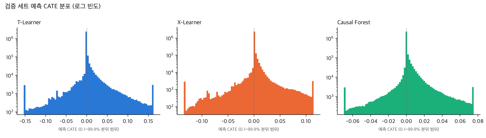
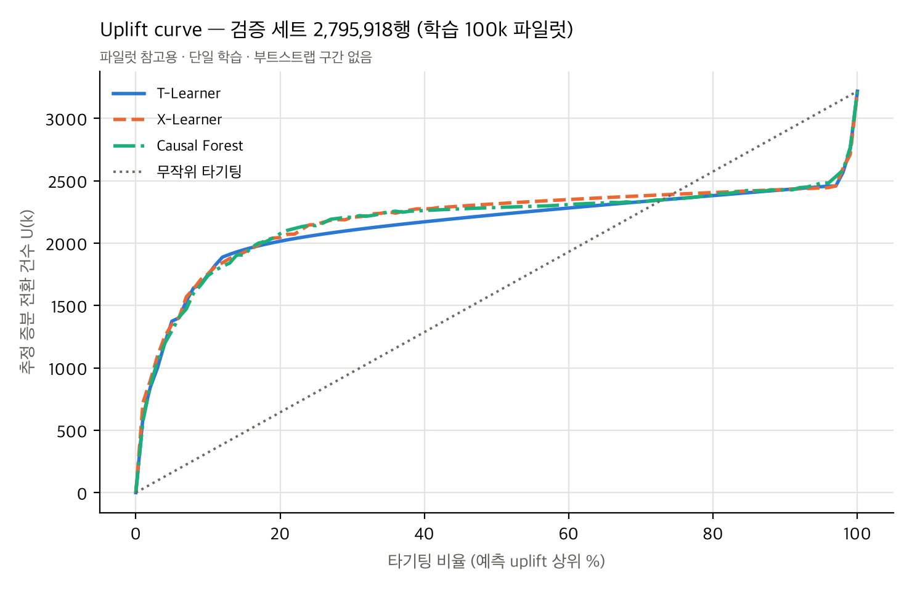
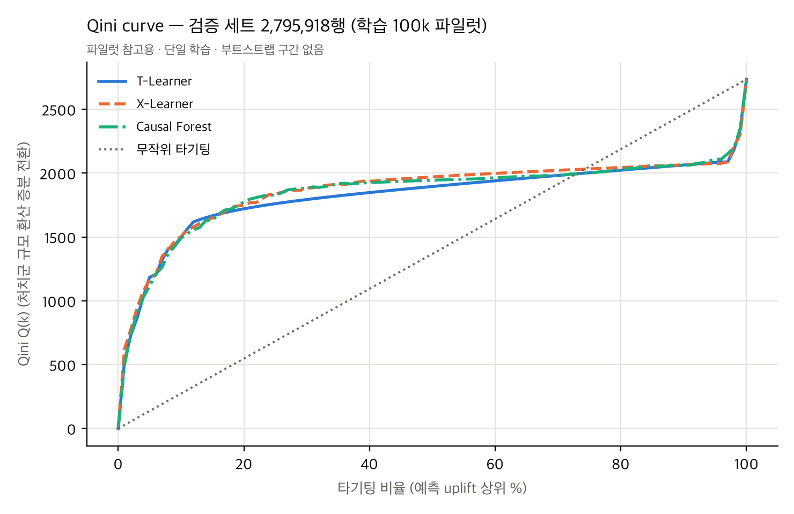

# STEP 5-3 보고서: Criteo 100k 파일럿 학습

- 작성일: 2026-11-11
- 범위: `train_100000`(100,000행)으로 T-Learner, X-Learner, Causal Forest를 각 1회 학습하고, 검증 세트(2,795,918행)에서 예측·평가
- **최종 테스트 세트는 불러오지도 않았습니다**(스크립트가 `test` 분할 사용을 거부합니다).
- 재현: `caffeinate -i .venv/bin/python scripts/criteo_pilot.py all --train train_100000 --tag pilot_100k`
- 학습 1회, 부트스트랩 구간 없음 → **모든 수치는 파일럿 참고값이며, 모델 우열의 근거로 쓰지 않습니다.**

## 1. 설정

### 이진 결과(conversion)에 대한 검토

STEP 4 모델 구현(`src/models.py`)은 수정 없이 재사용했습니다. 이진 Y에도 그대로 적합하다고 판단한 근거는 다음과 같습니다.

| 항목 | 검토 결과 |
|---|---|
| T-Learner | `RandomForestRegressor`로 0/1 Y를 회귀하면 $E[Y\mid X]=P(Y=1\mid X)$를 추정합니다. $\hat\mu_1-\hat\mu_0$는 전환확률 차이므로 [-1, 1] 범위입니다. |
| X-Learner | 대리 효과 $D_1 = Y-\hat\mu_0(X)$, $D_0=\hat\mu_1(X)-Y$는 [-1, 1]의 연속값이므로 회귀가 적절합니다. 성향점수는 학습 표본의 처치 비율 0.85(무작위 배정)를 씁니다. |
| CausalForestDML | 공식 API(econml 0.17)는 `discrete_outcome=False`(기본값)일 때 `model_y`로 회귀모형을 요구합니다. 0/1 Y의 잔차화 $Y-E[Y\mid X]$는 그대로 유효합니다. `discrete_treatment=True`이고 `model_t`는 분류기여야 하므로 `DummyClassifier(prior)`를 씁니다. 이 경우 성향점수는 각 fold의 처치 비율(≈0.85)입니다. 정수 `cv=5`일 때 econml은 T로 층화한 셔플 StratifiedKFold로 교차적합합니다. |

결론적으로 구조 변경은 필요하지 않았습니다. 그래도 STEP 4 설정 파일을 건드리지 않도록 **Criteo 전용 설정 `configs/criteo_models.yaml`** 을 따로 만들었고, 값은 STEP 4와 같습니다.

| 항목 | 값 |
|---|---|
| seed (모든 모델 `random_state`) | 42 |
| RF 기본 학습기 | `n_estimators=200, min_samples_leaf=5, max_features=1.0, n_jobs=1` |
| X-Learner 성향점수 | 학습 표본 처치 비율 0.8500 |
| Causal Forest | `n_estimators=1000, min_samples_leaf=5, max_features=1.0, honest=True, cv=5`, `model_y`=위 RF, `model_t`=`DummyClassifier(prior)`, `discrete_treatment=True`, 그 외 econml 기본값(`max_samples=0.45`, `inference=True`, `criterion="mse"`) |
| 예측 | 배치 200,000행. 고정 부분집합 50,000행(seed 42)을 먼저 예측하고, 전체 예측 추정 시간이 120분을 넘으면 중단하도록 설정 |

학습 시작 시 설정과 seed를 출력했고, 각 모델의 실행 기록(`data/criteo/predictions/pilot_100k/*_run.json`)과 `results/tables/criteo_pilot_100k_metadata.json`에 저장했습니다.

### 학습·검증 데이터

| | 행 수 | 처치 / 대조 | 전환: 처치 / 대조 |
|---|---|---|---|
| 학습 `train_100000` | 100,000 | 85,000 / 15,000 | 263 / **29** |
| 검증 `valid` | 2,795,918 | 2,376,530 / 419,388 | 7,342 / 813 |

입력은 `f0`~`f11`만 썼고, `visit`·`exposure`는 읽지 않았습니다. 세 모델은 같은 학습·검증 행을 사용했습니다. 검증 예측은 원본 행 번호(`row_id`)와 함께 저장했고, 평가 전에 STEP 5-2 인덱스 파일과 순서가 정확히 같은지 확인했습니다. 또 같은 50,000행에 대한 부분집합 예측과 전체 예측이 일치하는지(차이 ≤ 1e-12)도 확인했습니다.

## 2. 실행 결과

모델마다 별도 프로세스에서 순차 실행했고, 각 프로세스는 `memory_guard`(상한 7,000 MB) 아래에서 돌았습니다.

| 모델 | 상태 | 학습 시간 | 학습 직후 최대 RSS | 프로세스 최대 RSS | 부분집합 50k 예측 | **검증 280만 행 예측** | 프로세스 전체 | 저장 모델 (압축) |
|---|---|---|---|---|---|---|---|---|
| T-Learner | 성공 | **16.7초** | 540 MB | 1,026 MB | 0.3초 | **16.6초** | 54초 | 1.5 MB |
| X-Learner | 성공 | **51.1초** | 546 MB | 1,086 MB | 0.8초 | **42.8초** | 117초 | 15.4 MB |
| Causal Forest | 성공 | **201.2초** | 2,287 MB | 2,436 MB | 4.6초 | **249.4초** | 490초 | 209 MB |

- 실행 전후 스왑 사용량은 세 모델 모두 0 MB였고, `memory_guard`가 개입한 적은 없습니다. 경고 메시지도 없었습니다.
- 데이터 로드는 학습 약 9.4초, 검증 약 9.5초 걸렸습니다(원본 gzip CSV를 청크로 읽음).
- 노트북은 배터리 전원(60%)에서 `caffeinate`로 실행했고, 중단은 없었습니다.

**메모리 구성 (저장 모델을 다시 불러와 pickle 크기로 측정).**
- T-Learner 6 MB: μ₀ 1 MB, μ₁ 5 MB
- X-Learner 45 MB: 2단계 τ 모델 39 MB
- Causal Forest 887 MB: **최종 causal forest 863 MB**, 교차적합 nuisance 23 MB

Causal Forest의 메모리는 거의 전부 최종 포레스트(1,000그루)가 차지합니다.

## 3. 예측 CATE 분포 (검증 세트)

| 모델 | 평균 | SD | 최소 | 1% | 중앙값 | 99% | 최대 | 음수 비율 | 고유값 수 | **최빈값 비중** | NaN/Inf |
|---|---|---|---|---|---|---|---|---|---|---|---|
| T-Learner | 0.00100 | 0.0167 | -0.587 | -0.025 | 0 | 0.050 | 0.534 | 3.4% | 198,224 | **84.8%** | 0 / 0 |
| X-Learner | 0.00102 | 0.0124 | -0.369 | -0.022 | 0 | 0.039 | 0.268 | 3.3% | 793,389 | 54.0% | 0 / 0 |
| Causal Forest | 0.00110 | 0.0076 | -0.197 | -0.012 | 0 | 0.031 | 0.132 | 42.6% | 1,655,204 | 19.3% | 0 / 0 |

- 세 모델 모두 NaN·Inf가 없고, 거의 상수로 수렴한 경우도 없습니다(`near_constant=False`).
- 예측 평균(0.0010~0.0011)은 검증 세트의 단순 전환율 차 0.00115와 비슷합니다. 학습 세트 예측 분포도 검증 세트와 비슷했습니다(`criteo_pilot_100k_predictions_summary.csv`).
- **T-Learner 예측의 84.8%가 정확히 0입니다.**
  - 대조군 전환이 29건뿐이라, μ₀ 트리의 대부분 잎이 전환 0인 순수 잎이 됩니다(μ₀ 모델 크기 1 MB).
  - μ₁도 대부분 영역에서 0을 예측하므로 차이가 0이 됩니다.
  - 이 동점 구간 안에서의 순위는 평가 코드가 무작위 순서의 기댓값으로 처리합니다. 즉 그 구간에서는 T-Learner가 순위 정보를 주지 못합니다.
- X-Learner도 54%가 같은 값입니다. Causal Forest는 동점이 가장 적지만, 음수 예측이 42.6%로 가장 많습니다.

## 4. 검증 세트 평가 (`results/tables/criteo_pilot_100k_metrics.csv`)

평가 정의는 STEP 5-2(`src/criteo_evaluation.py`)와 같습니다. 비율 추정량을 쓰고, 격자는 φ = 0, 0.01, …, 1이며, 동점은 블록 보간합니다. 세 모델 모두 정의 불가 격자점은 0개입니다.

검증 세트 전체를 처치할 때의 증분 전환은 $U(N) = 3{,}217.6$건, $Q(N) = 2{,}735.0$건입니다.

| 모델 | AUUC (원값) | AUUC − 무작위 | **정규화 AUUC** | Qini 면적 | **Qini coefficient** | 정규화 Qini | AUUC − 무작위 (IPW 확인) |
|---|---|---|---|---|---|---|---|
| T-Learner | 2,139.9 | 531.0 | 0.165 | 1,822.5 | 455.0 | 0.166 | 582.6 |
| X-Learner | 2,188.6 | 579.8 | 0.180 | 1,864.4 | 496.9 | 0.182 | 647.2 |
| Causal Forest | 2,171.7 | 562.9 | 0.175 | 1,849.8 | 482.3 | 0.176 | 620.2 |
| 무작위 (모든 점수 동일) | 1,608.8 | 0 | 0 | 1,367.5 | 0 | 0 | — |

- 단위: AUUC와 Qini 관련 값은 전환 건수, 정규화 값은 무단위입니다. 정규화 AUUC = (AUUC − U(N)/2) / U(N)입니다.
- U(N) = 3,217.6 > 0이므로 정규화 값은 정의상 유효합니다.

### 상위 타기팅 성과

| 모델 | 상위 10% 증분 전환율 | 상위 10% 증분 전환 | 상위 20% 증분 전환율 | 상위 20% 증분 전환 | 상위 30% 증분 전환율 | 상위 30% 증분 전환 |
|---|---|---|---|---|---|---|
| T-Learner | 0.00625 | 1,747 | 0.00360 | 2,015 | 0.00251 | 2,104 |
| X-Learner | 0.00627 | 1,754 | 0.00366 | 2,045 | 0.00263 | 2,207 |
| Causal Forest | 0.00622 | 1,739 | 0.00371 | 2,076 | 0.00263 | 2,207 |
| 무작위 | 0.00115 | 322 | 0.00115 | 644 | 0.00115 | 965 |

- 증분 전환 건수 = 해당 구간의 (처치군 전환율 − 대조군 전환율) × 타기팅 인원입니다. 상위 10%의 타기팅 인원은 279,592명입니다.
- 상위 10% 구간의 대조군 전환은 423~482건입니다.

### 해석 (파일럿 범위)

- 세 모델 모두 무작위 타기팅보다 뚜렷하게 높은 곡선을 보였습니다.
  - 상위 10%의 증분 전환율은 평균의 약 5.4배입니다.
  - 상위 10%만 타기팅해도 전체 처치 시 증분 전환(3,218건)의 약 54%에 해당하는 추정치가 나옵니다.
- **세 모델 간 차이는 작습니다.** AUUC 차이는 최대 약 2%이고, 상위 10% 증분 전환 차이는 15건 이내입니다. 부트스트랩 구간이 없는 단일 학습 결과이고 학습 대조군 전환이 29건뿐이므로, **순위를 판단하지 않습니다.**
- **순위 하단의 역전 현상.** 곡선의 마지막 3% 구간에서 U(k)가 다시 급상승합니다(97% 지점 2,458~2,533 → 100% 지점 3,218).
  - 예측값이 가장 낮은 하위 3% 고객(약 84,000명)의 실제 전환율 차를 직접 계산하면 다음과 같습니다.

    | 모델 | 처치군 전환율 | 대조군 전환율 | 전환율 차 |
    |---|---|---|---|
    | T-Learner | 3.09% | 2.40% | 0.0069 |
    | X-Learner | 2.71% | 2.00% | 0.0071 |
    | Causal Forest | 2.90% | 2.21% | 0.0068 |

  - 차이는 평균(0.00115)의 약 6배로, 상위 10%와 비슷한 수준입니다. 즉 세 모델 모두 **증분 효과가 큰 고객군 일부를 음수로 예측해 맨 아래에 두고 있습니다.**
  - 이 고객군은 기저 전환율도 높습니다(대조군 2.0~2.4%, 평균 0.19%). 전환이 많은 영역에서 $\hat\mu_1-\hat\mu_0$의 추정 분산이 커서 예측이 양쪽 꼬리로 흩어진 것으로 보이나, 원인은 아직 확인하지 않았습니다.
  - STEP 5-4에서 학습 규모를 키웠을 때 이 현상이 줄어드는지 확인할 항목입니다.

## 5. 오류·경고

- 학습·예측 오류는 없었고, econml·sklearn 경고도 출력되지 않았습니다. 스왑 증가나 메모리 상한 도달도 없었습니다.
- 그래프 제목과 부제가 겹쳐서 제목 여백을 조정한 뒤 평가 단계만 다시 실행했습니다. 지표 CSV는 이전 실행과 동일합니다.
- 단위 테스트에서 소형 Causal Forest(20그루)가 out-of-bag 예측 부족 경고를 1건 냅니다. 테스트용 축소 설정 때문이며, 실제 실행과는 무관합니다.

## 6. 300k / 1M 확장 가능성 (실측 기반 추정)

근거는 이번 100k 실측값입니다. 아래 추정은 외삽이며 불확실성이 큽니다.
- 트리 학습 시간은 대략 $n\log n$, 포레스트 노드 수와 메모리는 대략 $n$에 비례한다고 가정했습니다.
- Criteo는 동점 특성값과 희귀 전환 때문에 트리 깊이가 데이터마다 달라질 수 있습니다. 실제 값은 이 범위를 벗어날 수 있습니다.

| 모델 | 100k 실측 (학습 / 최대 RSS / 검증 예측) | 300k 추정 | 1M 추정 | 판단 |
|---|---|---|---|---|
| T-Learner | 17초 / 1.0 GB / 17초 | 학습 약 1분, 메모리 1~1.5 GB | 학습 약 3~4분, 메모리 1.5~2.5 GB | 300k·1M 모두 가능 |
| X-Learner | 51초 / 1.1 GB / 43초 | 학습 약 3분, 메모리 1.5 GB 내외 | 학습 약 10~12분, 메모리 2~3 GB | 300k·1M 모두 가능 |
| Causal Forest | 201초 / 2.4 GB / 249초 | 학습 약 11~13분, **최종 포레스트 약 2.6 GB → 최대 RSS 약 5~7 GB**, 예측 5~8분 | 학습 약 40~50분, **포레스트만 약 8~9 GB → 최대 RSS 15 GB 이상 가능** | 300k는 가능하지만 7 GB 상한에 근접. **1M은 현재 설정으로 16 GB에서 위험** |

**병목은 Causal Forest의 최종 포레스트 메모리입니다**(100k에서 863 MB이며, 대부분 1,000그루 × 잎 5개 기준의 노드 수).

**시간·메모리 단축 방안.** 모두 설정 변경이므로, 적용하려면 검증 세트 기준으로 사전에 정하고 문서화해야 합니다.
- `min_samples_leaf` 확대(예: 50~200)
  - 노드 수와 메모리가 거의 반비례로 줄어듭니다.
  - 전환율 0.29%인 이진 결과에서 잎 5개는 대부분 전환 0인 잎이 되므로, 통계적으로도 검토할 근거가 있습니다(T-Learner의 84.8% 동점 현상).
  - 다만 세 모델에 같은 원칙으로 적용해야 공정합니다.
- Causal Forest `n_estimators` 축소(예: 1,000 → 500): 메모리·시간이 거의 절반이 됩니다.
- `n_jobs`를 2~4로 늘리면 학습·예측 시간을 줄일 수 있습니다. STEP 4와의 시간 비교성이 깨지고 메모리가 늘 수 있어 실측이 필요합니다.
- 검증 예측은 이미 배치 처리 중입니다. Causal Forest 예측(249초)은 트리 수에 비례하므로 트리 축소의 효과가 큽니다.

**더 큰 학습 표본이 필요한가.** 필요하다고 봅니다.
- 학습 대조군 전환 29건으로는 μ₀나 대조군 쪽 효과 추정이 사실상 거의 학습되지 않습니다(T-Learner 85% 동점).
- 300k에서는 87건, 1M에서는 291건으로 늘어납니다.
- 모델 간 차이가 작으므로, 비교에는 학습 규모 확대와 검증 세트 부트스트랩 구간이 모두 필요합니다.

## 7. STEP 5-4 추천

1. **300k에서 세 모델을 같은 설정으로 실행합니다.** `train_300000`이 이미 100k를 포함하므로 학습 규모 효과를 직접 비교할 수 있습니다. 실행 중 `memory_guard`(7,000 MB)로 Causal Forest를 감시합니다.
2. **1M은 T·X만 현재 설정으로 진행합니다.** Causal Forest는 메모리 축소 설정(잎 크기·트리 수)을 검증 세트 기준으로 먼저 정한 뒤 진행할지 결정합니다. 이 결정에는 최종 테스트를 쓰지 않습니다.
3. **검증 세트에서 짝 부트스트랩을 실행합니다**(B=1,000, 예상 약 5.5분, STEP 5-2 실측 기반). 모델 간 AUUC·Qini 차이의 구간을 확인합니다.
4. 최종 테스트 평가는 학습 규모와 설정이 모두 확정된 뒤 한 번만 합니다.

## 8. 생성·수정 파일

| 구분 | 파일 |
|---|---|
| 신규 설정 | `configs/criteo_models.yaml` (STEP 4의 `configs/models.yaml`은 변경 없음) |
| 신규 코드 | `src/criteo_models.py`, `scripts/criteo_pilot.py` |
| 신규 테스트 | `tests/test_criteo_models.py` (8개). 전체 109개 통과 |
| 신규 결과 | `results/tables/criteo_pilot_100k_{metrics,runtime,predictions_summary}.csv`, `criteo_pilot_100k_metadata.json` |
| 신규 그래프 | `results/figures/criteo_pilot_100k/{uplift_curve_valid,qini_curve_valid,prediction_distribution_valid}.{png,pdf}` |
| 모델·예측 (Git 제외) | `data/criteo/models/pilot_100k/{T,X,CF}.joblib` (241 MB), `data/criteo/predictions/pilot_100k/` (검증 예측 `*_valid.npz` 3개, 실행 기록, 메모리 로그, 96 MB) |
| 수정 | `.gitignore`에 `results/figures/criteo_pilot_100k/` 예외 2줄 추가 |
| 문서 | `docs/criteo_step5_3_pilot_report.md` |

STEP 4, STEP 5-1, STEP 5-2 결과 파일은 변경되지 않았습니다(MD5로 확인). Git commit/push는 하지 않았습니다.
