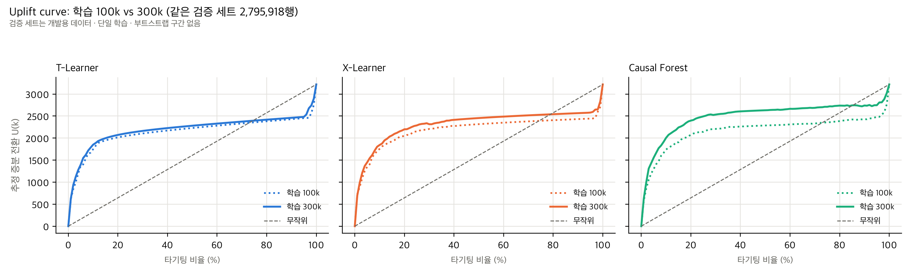
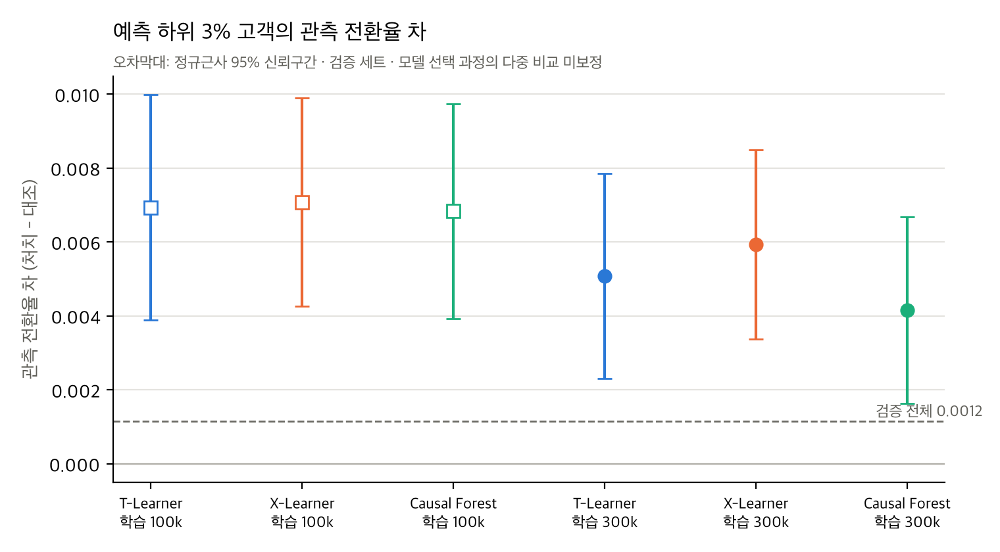

# STEP 5-4 보고서: Criteo 300k 학습 및 100k 비교

- 작성일: 2026-11-11
- 범위: `train_300000`(300,000행, 100k 포함)으로 T-Learner, X-Learner, Causal Forest를 각 1회 학습했습니다. 이어서 STEP 5-3과 **같은 검증 세트(2,795,918행)·같은 설정·같은 seed·같은 평가 코드**로 100k 결과와 비교했습니다.
- **최종 테스트 세트는 사용하지 않았습니다.** 1M 학습과 하이퍼파라미터 변경도 하지 않았습니다.
- 검증 세트는 모델·규모 선택에 쓰는 개발 데이터입니다. 아래 수치는 **최종 일반화 성능이 아니며**, 단일 학습·부트스트랩 구간 없는 참고값입니다.

## 재현

```bash
caffeinate -i .venv/bin/python scripts/criteo_step5_4.py run --models T X --train train_300000 --tag 300k
caffeinate -i .venv/bin/python scripts/criteo_step5_4.py run --models CF --train train_300000 --tag 300k
.venv/bin/python scripts/criteo_step5_4.py compare --base pilot_100k --new 300k
```

`run`은 STEP 5-3의 `scripts/criteo_pilot.py`(`fit`, `evaluate`)를 수정 없이 호출합니다. 모델마다 별도 프로세스에서 실행하며, `memory_guard`의 상한은 7,000 MB입니다. 이미 기록된 모델은 다시 실행하지 않습니다.

## 1. 실행 순서와 Causal Forest 메모리 재검토

1. T-Learner, X-Learner를 순서대로 학습했습니다(모두 성공, 스왑 0 MB).
2. Causal Forest를 실행하기 전에, 100k 실측값으로 300k 메모리를 다시 추정했습니다.
   - 100k Causal Forest 트리 1그루의 노드는 평균 5,920개였습니다. 잎 수가 `min_samples_leaf=5`와 균형 제약이 허용하는 최대치의 약 66%로, 이미 포화에 가까웠습니다. 그래서 포레스트 크기는 표본에 거의 비례할 것으로 판단했습니다.
   - 참고로 X-Learner의 τ₁ 모델은 100k→300k에서 노드가 4.1배로 늘어 비례보다 빨랐습니다. 이는 작은 표본에서 순수 잎이 많아 생긴 현상으로 보았고, 연속 잔차를 쓰는 Causal Forest에는 해당하지 않는다고 판단했습니다.
   - 100k의 학습 후 RSS(기본 약 0.56 GB + 모델 약 1.55 GB + 일시 증가 0.17 GB)를 3배로 키우면 최대 약 **5.2~5.9 GB**입니다(4배라면 약 7 GB). 7 GB 상한보다 낮고, 물리 메모리 여유도 약 10 GB였습니다. 상한을 넘더라도 `memory_guard`가 안전하게 종료하므로 실행했습니다.
3. **실측 결과: 최대 RSS 3,812 MB**로 추정보다 낮았습니다. 100k의 학습 후 RSS에 해제 전 임시 메모리가 섞여 있어 추정이 보수적이었습니다. 포레스트 노드는 정확히 3.0배(트리당 5,920 → 17,732개, pickle 887 MB → 2,643 MB)로 늘어 비례 가정이 맞았습니다.

## 2. 학습·예측 시간과 메모리

| 모델 | 학습 100k → 300k | 검증 예측 100k → 300k | 최대 RSS 100k → 300k | 저장 모델 (압축) 100k → 300k | 결과 |
|---|---|---|---|---|---|
| T-Learner | 16.7 → **60.3초** (×3.6) | 16.6 → 22.5초 | 1,026 → **1,045 MB** | 1.5 → 4.4 MB | 성공 |
| X-Learner | 51.1 → **176.6초** (×3.5) | 42.8 → 56.6초 | 1,086 → **1,358 MB** | 15 → 56 MB | 성공 |
| Causal Forest | 201.2 → **726.1초** (×3.6) | 249.4 → 314.8초 | 2,436 → **3,812 MB** | 209 → 616 MB | 성공 |

- 스왑은 모두 0 → 0 MB였고, 경고나 오류는 없었습니다.
- 학습 시간은 3배의 데이터에서 3.5~3.6배로 늘어 $n^{1.15}$ 정도의 증가입니다.
- 모델은 `data/criteo/models/300k/{T,X,CF}.joblib`(685 MB, Git 제외)에 저장했으며, 다시 불러와 재학습 없이 예측할 수 있습니다.

## 3. 검증 세트 성능 비교 (`results/tables/criteo_100k_vs_300k.csv`)

| 모델 | 학습 | AUUC | 정규화 AUUC | Qini coefficient | 상위 10% 증분 전환 (전환율 차) | 상위 20% | 상위 30% |
|---|---|---|---|---|---|---|---|
| T-Learner | 100k | 2,139.9 | 0.165 | 455.0 | 1,747 (0.00625) | 2,015 (0.00360) | 2,104 (0.00251) |
| T-Learner | 300k | 2,194.9 | 0.182 | 502.0 | 1,850 (0.00662) | 2,071 (0.00370) | 2,163 (0.00258) |
| X-Learner | 100k | 2,188.6 | 0.180 | 496.9 | 1,754 (0.00627) | 2,045 (0.00366) | 2,207 (0.00263) |
| X-Learner | 300k | 2,316.1 | 0.220 | 606.9 | 1,843 (0.00659) | 2,199 (0.00393) | 2,315 (0.00276) |
| Causal Forest | 100k | 2,171.7 | 0.175 | 482.3 | 1,740 (0.00622) | 2,076 (0.00371) | 2,207 (0.00263) |
| Causal Forest | 300k | **2,489.7** | **0.274** | **754.3** | **2,006 (0.00717)** | **2,397 (0.00429)** | **2,533 (0.00302)** |
| 무작위 | — | 1,608.8 | 0 | 0 | 322 (0.00115) | 644 | 965 |

**300k − 100k 변화:**

| 모델 | AUUC | 정규화 AUUC | Qini coefficient |
|---|---|---|---|
| T-Learner | +55.0 | +0.017 | +47.1 |
| X-Learner | +127.4 | +0.040 | +109.9 |
| Causal Forest | +318.0 | +0.099 | +272.0 |

- 정규화 AUUC = (AUUC − U(N)/2)/U(N)이고, U(N) = 3,217.6 > 0이므로 유효합니다. 정의 불가 격자점은 모든 모델에서 0개입니다.
- 학습을 3배로 늘리자 세 모델 모두 검증 지표가 올랐고, 증가 폭은 Causal Forest가 가장 컸습니다.
- 300k에서는 Causal Forest의 지표가 가장 높습니다. **하지만 다음 이유로 우열을 결론짓지 않습니다.**
  - 학습은 모델당 1회입니다. 다른 seed나 다른 표본에서의 변동을 모릅니다.
  - 부트스트랩 구간이 없습니다.
  - 검증 세트는 선택 과정에 쓰이는 개발 데이터입니다.



## 4. 분석 ①: T-Learner의 예측값 0 문제

| 모델 | 학습 (대조군 전환) | 예측값 0 비율 | 최빈값(=0) 비율·최대 동점 블록 | 고유값 수 | 동점 블록에 속한 행 비율 | 평균 / SD | 최소 / 최대 | 음수 비율 |
|---|---|---|---|---|---|---|---|---|
| T-Learner | 100k (29) | 84.8% | 84.8% · 2,371,743행 | 198,224 | 93.7% | 0.00100 / 0.0167 | −0.587 / 0.534 | 3.4% |
| T-Learner | 300k (87) | **83.6%** | 83.6% · 2,336,134행 | 230,762 | 92.7% | 0.00108 / 0.0134 | −0.493 / 0.526 | 5.3% |
| X-Learner | 100k | 54.0% | 54.0% · 1,510,310행 | 793,389 | 73.8% | 0.00102 / 0.0124 | −0.369 / 0.268 | 3.3% |
| X-Learner | 300k | 55.5% | 55.5% · 1,551,680행 | 868,944 | 71.1% | 0.00102 / 0.0102 | −0.322 / 0.219 | 5.5% |
| Causal Forest | 100k | 19.3% | 19.3% · 538,294행 | 1,655,204 | 51.2% | 0.00110 / 0.0076 | −0.197 / 0.132 | 42.6% |
| Causal Forest | 300k | **13.4%** | 13.4% · 374,858행 | 2,027,328 | 37.0% | 0.00095 / 0.0074 | −0.255 / 0.135 | 48.4% |

- **T-Learner의 0 예측 문제는 거의 개선되지 않았습니다**(84.8% → 83.6%). 학습 대조군 전환이 29건에서 87건으로 늘어도 전체 행 대비로는 여전히 드뭅니다(0.19%). 그래서 μ₀와 μ₁ 트리의 대부분 잎이 전환 0인 잎으로 남습니다. 이 동점 블록 안의 순위 정보는 여전히 없습니다.
- X-Learner의 0 비율은 거의 같습니다(54% → 56%).
- Causal Forest만 동점이 뚜렷하게 줄었습니다(19% → 13%). 세 모델 모두 NaN·Inf는 없고, 예측이 상수로 수렴하지도 않았습니다.

## 5. 분석 ②: 예측 하위 3% 고객 (`results/tables/criteo_300k_bottom3_segment.csv`)

검증 세트에서 예측값이 가장 낮은 3%(83,878명)의 관측 전환율 차입니다. 신뢰구간은 정규근사 95%입니다.

| 모델 | 학습 | 처치 / 대조 행 수 | 전환: 처치 / 대조 | 전환율: 처치 / 대조 | **전환율 차** | 95% CI |
|---|---|---|---|---|---|---|
| T-Learner | 100k | 72,256 / 11,622 | 2,236 / 279 | 3.09% / 2.40% | **0.00694** | [0.00388, 0.01000] |
| X-Learner | 100k | 72,378 / 11,500 | 1,960 / 230 | 2.71% / 2.00% | **0.00708** | [0.00426, 0.00990] |
| Causal Forest | 100k | 71,947 / 11,931 | 2,084 / 264 | 2.90% / 2.21% | **0.00684** | [0.00393, 0.00975] |
| T-Learner | 300k | 72,060 / 11,818 | 1,805 / 236 | 2.50% / 2.00% | **0.00508** | [0.00231, 0.00785] |
| X-Learner | 300k | 71,866 / 12,012 | 1,653 / 205 | 2.30% / 1.71% | **0.00593** | [0.00337, 0.00850] |
| Causal Forest | 300k | 71,762 / 12,116 | 1,512 / 205 | 2.11% / 1.69% | **0.00415** | [0.00162, 0.00668] |
| 검증 전체 | — | 2,376,530 / 419,388 | 7,342 / 813 | 0.309% / 0.194% | 0.00115 | [0.00100, 0.00130] |

- 300k에서도 현상이 남아 있지만, 크기는 줄었습니다.
  - 하위 3%의 전환율 차가 세 모델 모두 작아졌습니다(0.0068~0.0071 → 0.0041~0.0059).
  - 그래도 여섯 경우 모두 95% CI 하한(최소 0.0016)이 검증 전체 평균(0.00115)보다 높습니다.
- 이 고객군은 기저 전환율이 높습니다(대조군 1.7~2.4%, 평균의 약 9~12배). 300k 모델은 이 구간의 기저 전환율도 100k보다 낮게 잡습니다. 즉 하위 3%에 들어가는 고객 구성이 바뀌었습니다.
- **우연인지 모델 예측 문제인지 단정하지 않습니다.** 근거는 다음과 같습니다.
  1. 이 구간은 100k 결과를 보고 나서 고른 사후 분석 대상입니다.
  2. 100k와 300k의 하위 3%는 같은 검증 행에서 뽑아 서로 겹치므로 독립된 재현이 아닙니다.
  3. CI는 구간 하나에 대한 정규근사이며 다중 비교 보정이 없습니다.
  4. 단일 학습이라 학습 변동을 반영하지 못합니다.

  다만 대조군 전환이 200건 이상인 구간에서 반복적으로 관측되므로, 최종 평가 전에 확인할 항목으로 남깁니다.
- `boundary_tie_rows`: 100k T-Learner는 하위 3% 경계값에 동점이 2,087행 있었습니다. 경계에서 어느 행을 넣을지는 입력 순서에 따르며, 영향은 작습니다.



## 6. 100k vs 300k 통계적 비교 가능성

**기존 코드로 비교할 수 있습니다.** `src/criteo_evaluation.py::paired_bootstrap`은 같은 검증 관측치에 대한 여러 점수 벡터를 받습니다. 그래서 {T, X, CF} × {100k, 300k} 6개 점수를 같은 층화 부트스트랩 표본(처치·대조 크기 고정)으로 평가해, 모델 간·학습 규모 간 짝비교를 할 수 있습니다.
- 기능 확인으로 B=2만 실행했습니다(1.5초). B=1,000이면 약 13분으로 추정됩니다. 대규모 부트스트랩은 실행하지 않았습니다.
- **한계:** 이 부트스트랩은 **검증 표본의 변동만** 반영합니다. 학습 표본과 seed에 따른 변동(모델당 1회 학습)은 반영하지 못합니다. 학습 변동까지 보려면 seed나 학습 부분표본을 바꿔 여러 번 다시 학습해야 합니다. 예를 들어 300k Causal Forest는 1회에 약 19분(학습 + 검증 예측)이 걸립니다.

## 7. Causal Forest 1M 확장 위험

| 근거 (실측) | 100k | 300k | 1M 외삽 |
|---|---|---|---|
| 트리당 노드 | 5,920 | 17,732 (×3.0) | 약 59,000 (×10) |
| 모델 pickle 크기 | 887 MB | 2,643 MB | **약 8.8 GB** |
| 최대 RSS | 2,436 MB | 3,812 MB | **약 9~11 GB** |
| 학습 시간 | 201초 | 726초 | 약 45~55분 ($n^{1.15}$ 가정) |
| 검증 예측 | 249초 | 315초 | 약 6~8분 |

- 포레스트 크기가 표본에 정확히 비례한다는 점이 확인되었습니다. 따라서 **현재 설정으로 1M Causal Forest는 7 GB 보호 기준을 넘을 것이 거의 확실합니다.** 16 GB 물리 메모리 기준으로도 스왑 위험이 큽니다. 압축 저장 시 모델 파일도 약 2 GB입니다.
- 학습 시간과 예측 시간 외삽은 불확실성이 큽니다. 메모리 외삽은 300k에서 비례성이 확인되어 비교적 근거가 강합니다.
- T-Learner와 X-Learner는 1M에서도 가능해 보입니다(300k 최대 RSS 1.0~1.4 GB, 학습 1~3분 → 1M 추정 학습 약 4~12분, 메모리 3 GB 이하). 단, 이번에는 실행하지 않았습니다.

## 8. 추천 학습 규모와 이후 계획

**최종 모델 비교 규모: 300k (권장).**
- 현재 사전 고정 설정 그대로 세 모델 모두가 7 GB 기준 안에서 실행되는 가장 큰 규모입니다.
- 100k보다 지표가 뚜렷하게 개선되었습니다.

1M 비교를 원하면 다음 두 방법이 있습니다. 둘 다 연구 설계를 바꾸는 결정이므로 사용자 판단이 필요합니다.
- **(a) 메모리 보호 기준을 올리는 방법.** 예를 들어 12 GB로 올리면 16 GB 기기에서 스왑 위험을 감수해야 합니다.
- **(b) Causal Forest 설정을 바꾸는 방법.** 예: `n_estimators` 1,000 → 300, 또는 `min_samples_leaf` 확대. 이 경우 STEP 4·100k·300k와 설정이 달라집니다. 변경은 검증 세트 기준으로 사전에 정하고 기록해야 하며, 공정성을 위해 세 모델에 같은 원칙을 적용할지도 함께 정해야 합니다.

**이후 계획**

1. **검증 세트 짝 부트스트랩**: 300k 세 모델과 100k 세 모델을 B=1,000으로 비교합니다(약 13분). 모델 간 AUUC·Qini 차이의 구간을 확인합니다.
2. **(선택) 학습 변동 확인**: 300k에서 seed를 바꿔 몇 차례 다시 학습해, 모델 간 차이가 학습 변동보다 큰지 봅니다. Causal Forest 1회에 약 19분이 걸립니다.
3. **최종 설정 확정**: 학습 규모와 하이퍼파라미터를 정하고 문서화합니다. 이후에는 변경하지 않습니다.
4. **최종 테스트 평가 (1회)**: 확정된 모델로 `test` 2,795,918행을 예측하고 같은 지표를 계산합니다. 같은 부트스트랩 짝비교로 95% 구간을 냅니다. 검증 결과와 테스트 결과는 구분해 보고하고, 테스트 결과를 본 뒤에는 모델을 다시 고르거나 조정하지 않습니다.

## 9. 생성·수정 파일

| 구분 | 파일 |
|---|---|
| 신규 코드 | `src/criteo_analysis.py` (동점·구간 효과 진단), `scripts/criteo_step5_4.py` |
| 신규 테스트 | `tests/test_criteo_analysis.py` (3개). **전체 112개 통과**. 남은 경고 1건은 테스트용 소형 포레스트의 out-of-bag 경고 |
| 신규 결과 | `results/tables/criteo_300k_{metrics,runtime,predictions_summary}.csv`, `criteo_300k_metadata.json`, `criteo_100k_vs_300k.csv`, `criteo_300k_bottom3_segment.csv` |
| 신규 그래프 | `results/figures/criteo_300k/` — `uplift_curve_valid`, `qini_curve_valid`, `prediction_distribution_valid`, `uplift_curve_100k_vs_300k`, `bottom3_segment_100k_vs_300k` (각 PNG/PDF) |
| 모델·예측 (Git 제외) | `data/criteo/models/300k/` (685 MB), `data/criteo/predictions/300k/` (96 MB, 행 번호 포함 검증 예측·실행 기록·메모리 로그) |
| 수정 | `.gitignore`에 `results/figures/criteo_300k/` 예외 2줄 추가 |
| 문서 | `docs/criteo_step5_4_report.md` |

- STEP 4, STEP 5-1~5-3 결과 파일과 100k 모델·예측 파일은 바뀌지 않았습니다(MD5로 확인).
- `configs/criteo_models.yaml`, `scripts/criteo_pilot.py`도 수정하지 않았습니다.
- Git commit/push는 하지 않았습니다.
