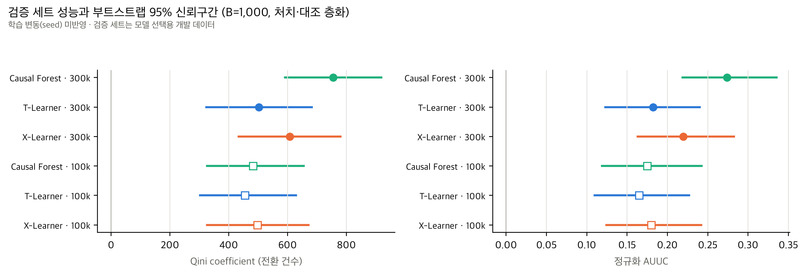
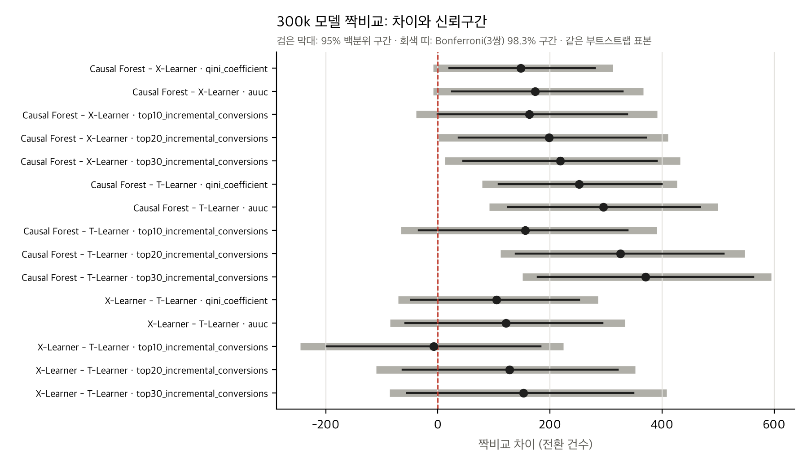

# STEP 5-5 보고서: Criteo 검증 데이터 통계적 비교 (부트스트랩)

- 작성일: 2026-11-11
- 범위: 저장된 300k 모델 3개(보조로 100k 모델 3개)의 **검증 세트 예측값**을 재사용한 짝 부트스트랩
- **재학습, 재실험, 최종 테스트 접근은 하지 않았습니다.**
- 재현: `caffeinate -i .venv/bin/python scripts/criteo_bootstrap.py --n-boot 1000 --seed 42` (총 368초, 최대 RSS 약 1.0 GB)

**해석 범위.**
- 학습은 모델당 1회입니다. 부트스트랩은 **검증 표본의 변동만** 반영하고, 학습 seed나 학습 표본의 변동은 반영하지 않습니다.
- 검증 세트는 학습 규모(300k)를 고르는 데 이미 쓰였습니다.
- 따라서 아래 결과는 최종 일반화 성능이 아닙니다.

## 1. 방법

| 항목 | 내용 |
|---|---|
| 데이터 | 검증 세트 2,795,918행(처치 2,376,530 / 대조 419,388, 전환 7,342 / 813). 예측값의 `row_id`가 STEP 5-2 인덱스와 일치하는지 확인 |
| 반복 | B = 1,000, seed 42 |
| 재표본 | 처치군·대조군을 각각 복원추출합니다(집단 크기 고정). 정수 가중치로 표현해 데이터를 복사하지 않습니다. |
| 짝비교 | 매 반복마다 **같은 가중치**를 모든 점수 벡터에 적용합니다. 점수 벡터는 300k T/X/CF, 100k T/X/CF(보조), 모든 점수가 같은 무작위 기준선입니다. |
| 평가 정의 | STEP 5-2의 `src/criteo_evaluation.py` 그대로입니다. 비율 추정량, 101점 격자 사다리꼴 적분, 동점 블록 선형 보간, 정규화 분모는 $U(N)$·$Q(N)$이고 0 이하일 때 NaN입니다. |
| 신뢰구간 | 백분위 95%. 모델 간 짝비교는 지표별로 3쌍에 Bonferroni 보정(98.33% 백분위 구간, $p \times 3$)을 함께 보고합니다. |
| 부트스트랩 p값 | $2\min\{P(d\le0), P(d\ge0)\}$. 해상도는 1/1,000이므로 0으로 나오면 **p < 0.002**로 표기합니다. |
| 1차 지표 | **Qini coefficient**. AUUC·정규화 지표는 Qini와 결론이 같았습니다. 상위 10/20/30% 성과는 2차 지표이며, 지표 간 다중성은 보정하지 않았습니다. |

### 구현 일치성 검증 (본 실행 전, 실제 검증 데이터에서)

| 검증 항목 | 결과 |
|---|---|
| CF·T 점수: 가중치를 모두 1로 둔 평가 = 가중치 없는 기존 평가 (같은 정렬·동점 블록) | 일치 |
| CF·T 점수: 부트스트랩 1회 가중치 평가 = 그 가중치만큼 행을 실제로 복제해 평가 | 일치. T-Learner는 동점 블록이 233만 행으로 가장 커서 동점 처리 검증에 해당합니다. |
| 가중치 합 = 처치군·대조군 원래 크기 | 일치 |
| `paired_bootstrap` = 가중치 생성 + `evaluate_uplift`를 직접 반복한 결과 (B=2) | 일치 |

**분모 0과 정의 불가 사례.**
- 1,000회 모두에서 정의되지 않는 격자점이 **0개**였고, 모든 지표에서 NaN 반복이 **0회**였습니다.
- 전체 증분 $U(N)$의 95% 구간이 [2,812, 3,618]로 0보다 커서, 정규화 AUUC와 정규화 Qini는 모든 반복에서 정의되었습니다.
- 상위 10% 구간의 대조군 전환은 반복별 최소 386건(T)~430건(X)으로, 분모 0 문제가 없었습니다.

## 2. 모델별 성능과 95% 신뢰구간 (`criteo_300k_bootstrap_summary.csv`)

| 모델 | 학습 | Qini coefficient [95% CI] | AUUC [95% CI] | 정규화 AUUC [95% CI] | 부트스트랩 SE (Qini) |
|---|---|---|---|---|---|
| T-Learner | 300k | 502.0 [323.4, 682.5] | 2,194.9 [1,849.8, 2,530.0] | 0.182 [0.123, 0.240] | 88.6 |
| X-Learner | 300k | 606.9 [433.3, 779.3] | 2,316.1 [1,967.5, 2,656.9] | 0.220 [0.163, 0.283] | 89.5 |
| **Causal Forest** | 300k | **754.3 [591.2, 918.9]** | **2,489.7 [2,151.7, 2,810.8]** | **0.274 [0.219, 0.335]** | 85.4 |
| T-Learner | 100k | 455.0 [302.3, 628.0] | 2,139.9 [1,845.3, 2,447.0] | 0.165 [0.110, 0.227] | 83.7 |
| X-Learner | 100k | 496.9 [325.7, 671.5] | 2,188.6 [1,864.3, 2,522.1] | 0.180 [0.124, 0.242] | 87.5 |
| Causal Forest | 100k | 482.3 [326.3, 655.0] | 2,171.7 [1,870.7, 2,486.5] | 0.175 [0.119, 0.242] | 85.7 |
| 무작위 기준선 | — | 0 | 1,608.8 [1,405.9, 1,809.2] | 0 | — |

- 정규화 Qini는 정규화 AUUC와 거의 같습니다(300k CF 0.276 [0.221, 0.338]).
- 모델별 구간은 서로 많이 겹칩니다. 하지만 세 모델이 같은 표본에서 강하게 함께 움직이므로, 우열은 아래 **짝비교 차이의 구간**으로 판단해야 합니다.



## 3. 300k 모델 짝비교 (`criteo_300k_paired_comparison.csv`)

| 비교 | 지표 | 차이 | 95% CI | Bonferroni(3쌍) 98.3% CI | p (보정 전 → 보정 후) |
|---|---|---|---|---|---|
| CF − X | **Qini coefficient** | +147.4 | [20.4, 279.9] | **[−8.1, 311.6]** | 0.024 → **0.072** |
| CF − X | AUUC | +173.7 | [25.1, 329.4] | [−8.7, 366.2] | 0.024 → 0.072 |
| CF − T | **Qini coefficient** | +252.3 | [108.3, 399.2] | **[79.1, 426.2]** | < 0.002 → **< 0.006** |
| CF − T | AUUC | +294.9 | [125.5, 467.2] | [91.7, 499.4] | < 0.002 → < 0.006 |
| X − T | **Qini coefficient** | +104.8 | [−47.6, 251.8] | [−71.1, 285.6] | 0.178 → 0.534 |
| X − T | AUUC | +121.2 | [−58.4, 293.4] | [−85.4, 333.3] | 0.186 → 0.558 |



## 4. 상위 타기팅 비율별 신뢰구간 (`criteo_300k_targeting_ci.csv`)

| 모델 (300k) | 상위 10%: 증분 전환율 / 증분 전환 [95% CI] | 상위 20% | 상위 30% |
|---|---|---|---|
| T-Learner | 0.00662 [0.00538, 0.00782] / 1,850 [1,504, 2,186] | 0.00370 / 2,071 [1,720, 2,405] | 0.00258 / 2,163 [1,816, 2,492] |
| X-Learner | 0.00659 [0.00536, 0.00782] / 1,843 [1,498, 2,186] | 0.00393 / 2,199 [1,826, 2,542] | 0.00276 / 2,315 [1,940, 2,674] |
| Causal Forest | 0.00717 [0.00597, 0.00836] / 2,006 [1,670, 2,337] | 0.00429 / 2,397 [2,059, 2,730] | 0.00302 / 2,533 [2,193, 2,860] |
| 무작위 | 0.00115 [0.00101, 0.00129] / 322 [281, 362] | 0.00115 / 644 [562, 724] | 0.00115 / 965 [844, 1,086] |

- 상위 10%는 279,592명, 20%는 559,184명, 30%는 838,775명입니다.
- 상위 10% 구간의 처치군은 약 24만 명, 대조군은 약 3.9만 명이고, 대조군 전환은 466~501건입니다.

**타기팅 성과의 짝비교 차이** (증분 전환 건수, 95% CI / Bonferroni 98.3% CI):

| 비교 | 상위 10% | 상위 20% | 상위 30% |
|---|---|---|---|
| CF − X | +163 [−0.2, 337] / [−39, 391] | +198 [37, 371] / [1, 410] | +218 [45, 390] / [12, 432] |
| CF − T | +155 [−34, 339] / [−66, 390] | +325 [139, 510] / [111, 547] | +371 [178, 562] / [151, 594] |
| X − T | −7 [−198, 183] / [−246, 224] | +128 [−63, 320] / [−110, 352] | +152 [−55, 349] / [−86, 408] |

## 5. 해석

### 5-1. Causal Forest가 수치상 가장 좋은가

그렇습니다. 300k 검증 세트에서 Causal Forest는 Qini coefficient, AUUC, 정규화 지표, 상위 10·20·30% 증분 전환 모두에서 **점추정치가 가장 높습니다.**

### 5-2. 모델 간 Qini 차이의 신뢰구간이 0을 포함하는가

- **CF − T: 0을 포함하지 않습니다.** 보정 전후 모두 그렇습니다(Bonferroni 98.3% CI [79, 426]). 검증 표본 변동 범위에서는 Causal Forest의 Qini가 T-Learner보다 높다고 볼 수 있습니다.
- **CF − X: 결론이 보정 여부에 따라 갈립니다.** 보정 전 95% CI [20, 280]는 0을 포함하지 않지만, 세 쌍 비교를 보정하면 [−8, 312]로 0을 포함합니다(보정 p = 0.072). **우위가 확인되었다고 말할 수 없습니다.**
- **X − T: 0을 포함합니다**(보정 전에도). 구분되지 않습니다.

### 5-3. 상위 10% 타기팅 성과 차이가 통계적으로 구분되는가

- **구분되지 않습니다.** 상위 10%에서는 세 쌍 모두 95% CI가 0을 포함합니다. CF − X는 하한이 −0.2로 경계에 걸쳐 있습니다.
- 상위 20%·30%에서는 CF − X와 CF − T가 보정 후에도 0을 제외합니다. 다만 이것은 2차 지표 여러 개 중 일부이고 지표 간 다중성을 보정하지 않았으므로 **탐색적 결과**로 둡니다.
- 덧붙여, 상위 20%·30% 구간에 들어가는 T-Learner 고객의 상당수는 예측값이 0인 동점 블록에서 옵니다(아래 5-5). 그래서 T-Learner와의 차이에는 "순위를 매기지 못하는 구간"의 영향이 섞여 있습니다.

### 5-4. 100k → 300k 성능 개선의 해석과 한계

같은 부트스트랩 표본으로 짝비교한 결과(Qini coefficient, 300k − 100k)입니다.

| 모델 | 차이 [95% CI] | 0 포함 |
|---|---|---|
| T-Learner | +47 [−125, 217] | 포함 |
| X-Learner | +110 [−55, 281] | 포함 |
| **Causal Forest** | **+272 [96, 445]** | 제외 |

Causal Forest의 상위 10% 증분 전환도 +266 [50, 494]로 0을 제외합니다.

**한계**
- 이 구간은 검증 표본 변동만 반영합니다. 학습을 한 번씩만 했으므로, 학습 seed와 표본을 바꿨을 때의 변동이 이 차이보다 작은지는 알 수 없습니다.
- 300k가 100k를 포함하는 중첩 표본이라는 점도 있습니다.
- 따라서 "학습 데이터가 늘면 Causal Forest가 특히 좋아진다"는 것은 **이 단일 학습 결과에서 관찰된 경향**입니다. 일반 법칙으로 주장하지 않습니다.

### 5-5. 300k 모델의 동점 문제

| 모델 (300k) | 예측값 0 비율 | 최대 동점 블록 | 동점 블록에 속한 행 |
|---|---|---|---|
| T-Learner | **83.6%** | 2,336,134행 | 92.7% |
| X-Learner | 55.5% | 1,551,680행 | 71.1% |
| Causal Forest | 13.4% | 374,858행 | 37.0% |

- T-Learner는 양수 예측이 약 11.2%뿐입니다. 그래서 상위 10%는 대부분 양수 점수로 채워지지만, 상위 20%·30%에는 0 블록의 일부가 들어갑니다.
- 그 부분의 성과는 평가 정의상 무작위 순서의 기댓값으로 계산됩니다(대조군 인원이 81,608.6처럼 소수로 나오는 이유). 즉 T-Learner는 상위 약 11%를 넘어서면 순위 정보를 거의 주지 못합니다.
- X-Learner도 절반 이상이 동점입니다.

### 5-6. 하위 3% 현상 (사후 탐색)

STEP 5-4의 하위 3% 분석은 100k 결과를 본 뒤 정한 사후 탐색입니다. 이번 확증 분석에는 포함하지 않았고, 결론에도 쓰지 않습니다.

## 6. 확인된 결론과 확인되지 않은 결론

**검증 표본 변동 범위에서 확인됨** (학습 변동 미반영, 검증 세트 기준)
- 세 모델 모두 무작위 타기팅보다 Qini·AUUC·상위 타기팅 성과가 높습니다. 모든 구간이 무작위 기준과 겹치지 않습니다.
- 300k Causal Forest의 Qini coefficient는 300k T-Learner보다 높습니다(Bonferroni 보정 후에도 0 제외).

**확인되지 않음**
- Causal Forest가 X-Learner보다 낫다는 것(Qini, 보정 후 0 포함).
- X-Learner가 T-Learner보다 낫다는 것.
- 상위 10% 타기팅에서의 모델 간 차이.
- 학습 seed를 바꿔도 위 순위가 유지되는지(측정하지 않음).
- 테스트 데이터·다른 기간·다른 캠페인으로의 일반화.

**탐색적 (다중성 미보정)**
- 상위 20%·30%에서 Causal Forest가 X·T보다 높음.
- Causal Forest만 100k → 300k 개선 구간이 0을 제외.
- 하위 3% 고객군의 높은 전환율 차.

## 7. 최종 테스트 평가에 사용할 확정 모델과 설정 (제안)

테스트는 모델을 **고르는** 단계가 아니라, 연구 대상인 **세 모델을 모두** 같은 조건에서 한 번 평가하는 단계입니다. 아래 설정을 테스트 데이터를 보기 전에 고정할 것을 제안합니다.

| 항목 | 확정안 |
|---|---|
| 모델 | 이미 학습된 300k 모델 3개를 재학습 없이 그대로 사용 |
| 모델 파일 SHA-256 | T `47c114a5…8305`, X `34c27a4a…be4b`, CF `73bf1f9d…f150` (전체 값은 아래) |
| 학습 데이터 | `train_300000` (SHA-256 `0c80d8c8…c584`), 처치 85% / 대조군 전환 87건 |
| 설정 | `configs/criteo_models.yaml` (SHA-256 `2b221b7e…6479`). STEP 4 하이퍼파라미터, seed 42, X-Learner 성향점수 0.85, CF `DummyClassifier(prior)`·`cv=5`·1,000그루 |
| 평가 데이터 | `test` 2,795,918행, 1회만 사용 |
| 지표 | 1차 Qini coefficient. 2차 AUUC, 정규화 AUUC·Qini, 상위 10/20/30% 증분 전환율·건수. 모두 STEP 5-2 정의 |
| 불확실성 | 처치·대조 층화 짝 부트스트랩 B = 1,000, seed 42. 1차 지표는 3쌍 Bonferroni 보정 |
| 보고 원칙 | 검증 결과와 테스트 결과를 구분합니다. 테스트 결과를 본 뒤에는 모델·설정·규모를 바꾸지 않습니다. |

모델 파일 SHA-256 전체 값:

```
47c114a5a062024f1dca5aca4b863452197280ba0e120be850f6bc83d66e8305  data/criteo/models/300k/T.joblib
34c27a4a6e0bf52e975f9818b580f00a54ca15d41a36a453756625117962be4b  data/criteo/models/300k/X.joblib
73bf1f9d9a2cbd97c8f43e4d7880a536be3b455523ee2da1689c90b16e93f150  data/criteo/models/300k/CF.joblib
2b221b7e449dbc1fac101984552c10e9a64449a1cc6d75bb8b4f852c7b926479  configs/criteo_models.yaml
0c80d8c8c343aa016542ad7e26e95fc4e8f6ff7c27c6b990eed7d2631308c584  data/criteo/splits/train_300000.npy
```

**테스트 전 선택 사항(사용자 결정).** 학습 변동을 확인하려면 테스트 전에 300k에서 seed를 바꿔 몇 차례 다시 학습하고 검증 세트에서 확인하는 방법이 있습니다. Causal Forest 1회에 약 19분이 걸립니다. 하지 않을 경우, 최종 보고서에 "모델당 단일 학습"이라는 한계를 명시합니다.

**예상 비용**: 테스트 세트 예측은 300k 실측 기준 T 약 23초, X 약 57초, CF 약 5분입니다. 부트스트랩은 300k 세 모델만 넣으면 약 3~4분으로 추정합니다.

## 8. 생성·수정 파일과 실행 시간

| 구분 | 파일 |
|---|---|
| 신규 코드 | `scripts/criteo_bootstrap.py` (기존 `src/criteo_evaluation.py`를 수정 없이 재사용) |
| 신규 결과 | `results/tables/criteo_300k_bootstrap_summary.csv`, `criteo_300k_paired_comparison.csv`, `criteo_300k_targeting_ci.csv`, `criteo_300k_bootstrap_metadata.json` (검증 결과, NaN 개수, 실행 시간 포함) |
| 신규 그래프 | `results/figures/criteo_300k_bootstrap/{model_ci, paired_differences_300k, qini_bootstrap_distribution_300k}.{png,pdf}` |
| 부트스트랩 반복값 (Git 제외) | `data/criteo/bootstrap/validation_draws_B1000_seed42.csv.gz` (0.9 MB) |
| 수정 | `.gitignore`에 `results/figures/criteo_300k_bootstrap/` 예외 2줄 추가 |
| 문서 | `docs/criteo_step5_5_report.md` |

**실행 시간**: 일치성 검증 3.3초, 부트스트랩 B = 1,000(7개 점수 벡터) 356초, 전체 368초, 최대 RSS 약 1.0 GB. 본 실행 전에 B = 3으로 시험 실행했고, 그 출력은 삭제했습니다.

**검증**
- pytest **112개 통과**. 남은 경고 1건은 테스트용 소형 포레스트의 out-of-bag 경고입니다.
- 기존 결과 파일, 100k·300k 모델·예측 파일은 바뀌지 않았습니다(MD5로 확인).
- 최종 테스트는 접근하지 않았고, Git commit/push는 하지 않았습니다.
