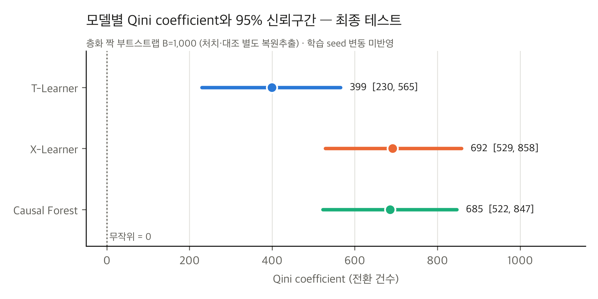
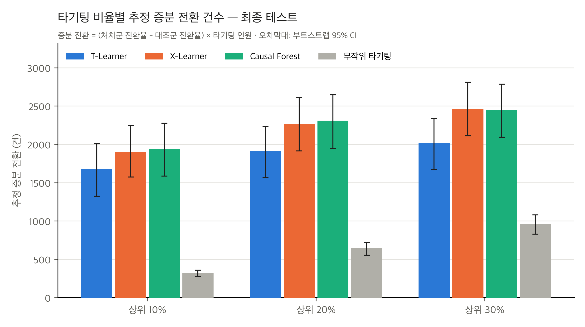
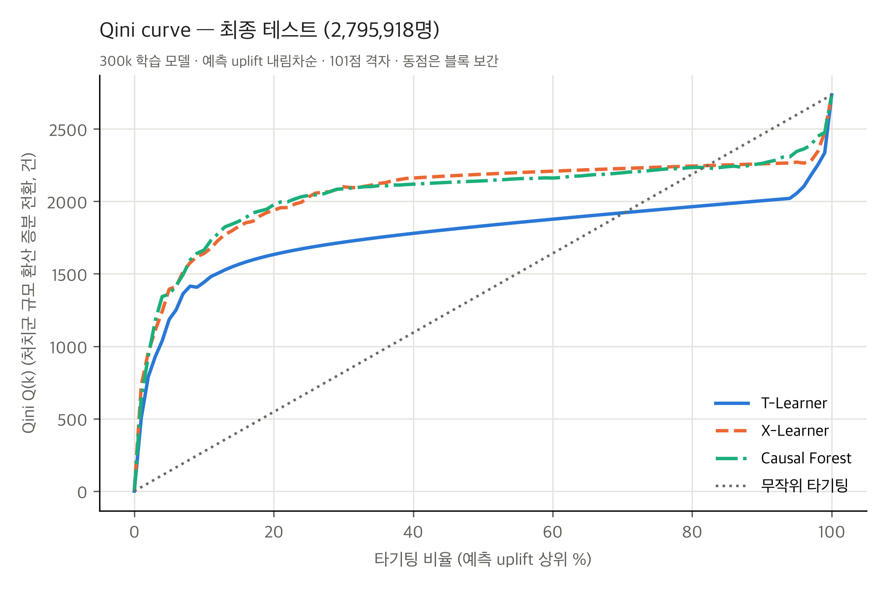

# STEP 5-6 최종 보고서: Criteo 최종 테스트 평가

- 작성일: 2026-11-11
- 범위: STEP 5-5에서 확정한 300k 학습 모델 3개(T-Learner, X-Learner, Causal Forest)를 **최종 테스트 세트(2,795,918행)에서 한 번** 평가했습니다.
- **재학습, 모델 선택, 하이퍼파라미터·학습 규모 변경, 평가 방법 변경은 하지 않았습니다.**
- 실행: `caffeinate -i .venv/bin/python scripts/criteo_final_test.py --split test` (`memory_guard` 7,000 MB 아래, 총 628초, 최대 RSS 3,076 MB)

## 1. 절차와 무결성 검증

1. **고정 설정 확인.** 모델 3개, `configs/criteo_models.yaml`, 분할 인덱스 4개(`train_300000`, `test`, `valid`, `train_pool`)의 SHA-256을 확인했습니다. 8개 모두 STEP 5-2·5-5에 기록된 값과 **일치**했습니다.
2. **분할 중복 확인.** 테스트 ∩ 검증, 테스트 ∩ 학습 풀, 테스트 ∩ `train_300000`은 모두 0행입니다.
3. **사전 드라이런.** 같은 스크립트를 **검증 세트**에 먼저 실행해 버그를 확인했습니다(출력은 스크래치 폴더에 두고, 예측 파일은 삭제).
   - 저장된 300k 검증 예측과 차이가 0이었고, STEP 5-4 지표와 일치했습니다.
   - 이 과정에서 테스트 데이터는 쓰지 않았습니다.
4. **테스트 실행(1회).** 저장 모델을 하나씩 불러와 20만 행 배치로 예측했습니다.
   - 행 번호가 분할 인덱스와 일치하는지 확인했습니다.
   - 고정 부분집합 5만 행을 다시 예측한 결과가 전체 예측과 일치하는지 확인했습니다.
   - 저장 파일을 다시 읽어 같은 값인지 확인했습니다.
   - 예측값에 NaN·Inf는 없었습니다.
5. **평가.** STEP 5-2의 `src/criteo_evaluation.py`를 **수정 없이** 사용했습니다. 테스트 세트에서 층화 짝 부트스트랩을 B=1,000, seed 42로 실행했습니다.
6. **그림 수정.** 그래프 하나(`qini_coefficient_ci`)의 라벨이 제목과 겹쳐서 그림만 다시 그렸습니다(`--figures-only`). 저장된 예측으로 다시 계산한 값이 저장된 지표와 같은지 확인했으며, 결과 표 5개의 MD5는 바뀌지 않았습니다.

테스트 세트 구성은 처치 2,376,530명, 대조 419,388명, 전환 처치 7,342건, 대조 813건입니다. 비례 층화 배분 때문에 검증 세트와 층별 인원이 정확히 같습니다. 그래서 전체 증분 $U(N) = 3{,}217.6$건도 검증 세트와 같습니다.

## 2. 평가지표 정의 (STEP 5-2와 동일)

모델 예측 uplift 점수로 테스트 고객을 내림차순 정렬하고, 상위 $k$명(비율 $\phi=k/N$)에서 다음을 셉니다.
- $N_t(k), N_c(k)$: 처치군·대조군 인원
- $Y_t(k), Y_c(k)$: 처치군·대조군 전환 수

| 지표 | 정의 | 단위 |
|---|---|---|
| 전환율 차 $d(k)$ | $Y_t(k)/N_t(k) - Y_c(k)/N_c(k)$ | 전환율 |
| **Uplift curve** $U(k)$ | $d(k)\cdot k$. 상위 $k$명 전원을 처치했을 때와 아무도 처치하지 않았을 때의 증분 전환 추정 | 전환 건수 |
| **Qini curve** $Q(k)$ | $Y_t(k) - Y_c(k)\,N_t(k)/N_c(k)$. 대조군을 처치군 규모로 환산한 증분 전환 | 전환 건수 |
| **AUUC** | $\int_0^1 U(\phi N)\,d\phi$ | 전환 건수 |
| **Qini coefficient** (주평가) | $\int_0^1 Q(\phi N)\,d\phi - Q(N)/2$. 무작위 타기팅 직선 아래 면적 대비 차이로, 무작위 = 0 | 전환 건수 |
| **정규화 AUUC** (보조) | $(\text{AUUC} - U(N)/2)\,/\,U(N)$. $U(N)\le0$이면 정의하지 않음 | 무단위 |
| 상위 $q$% 증분 전환 | 증분 전환율 $d(qN)$, 증분 전환 건수 $d(qN)\times qN$ | 전환율 / 건수 |

**공통 규칙**
- 적분은 $\phi \in \{0, 0.01, \dots, 1\}$ 101점 격자의 사다리꼴 적분입니다.
- 동점 점수는 블록 단위로 선형 보간합니다. 무작위 순서의 기댓값에 해당합니다.
- 85:15 불균형은 집단별 분모로 반영합니다.

**무작위 기준선**: 모든 고객의 점수가 같다고 둔 경우입니다.

**사전 판정 기준(STEP 5-5에서 고정)**
- 무작위보다 우수하다 = Qini coefficient의 95% 백분위 신뢰구간이 0보다 큼.
- 모델 간 차이 = 같은 부트스트랩 표본에서 계산한 Qini 차이의 Bonferroni(3쌍) 98.33% 구간이 0을 포함하지 않음.

## 3. 결과

### 3-1. 모델별 지표와 95% 신뢰구간 (`criteo_final_test_bootstrap.csv`)

| 모델 | **Qini coefficient** [95% CI] | AUUC [95% CI] | AUUC − 무작위 [95% CI] | 정규화 AUUC [95% CI] | 무작위보다 우수 (사전 기준) |
|---|---|---|---|---|---|
| T-Learner | **399.2** [229.9, 565.3] | 2,073.6 [1,734.4, 2,388.4] | 464.8 [266.4, 659.8] | 0.144 [0.085, 0.203] | 예 |
| X-Learner | **691.7** [528.5, 858.0] | 2,415.4 [2,073.1, 2,747.2] | 806.5 [615.4, 1,001.9] | 0.251 [0.199, 0.311] | 예 |
| Causal Forest | **685.4** [522.3, 846.6] | 2,407.8 [2,066.7, 2,737.7] | 799.0 [607.9, 988.2] | 0.248 [0.193, 0.304] | 예 |
| 무작위 기준선 | 0 | 1,608.8 [1,380.2, 1,796.4] | 0 | 0 | — |

- 1,000회 모두에서 NaN과 정의 불가 격자점은 0개였습니다.
- $U(N)$의 95% 구간은 [2,760, 3,593]으로 0보다 커서, 정규화 지표는 항상 정의되었습니다.

### 3-2. 짝비교 (`criteo_final_test_paired.csv`)

| 비교 | Qini 차이 | 95% CI | **Bonferroni 98.3% CI** | p (보정 전 → 보정 후) | 판정 |
|---|---|---|---|---|---|
| Causal Forest − T-Learner | **+286.2** | [129.1, 435.4] | **[97.0, 472.2]** | < 0.002 → < 0.006 | **유의** |
| Causal Forest − X-Learner | −6.3 | [−147.5, 126.1] | [−176.2, 157.2] | 0.93 → 1.00 | 유의하지 않음 |
| X-Learner − T-Learner | **+292.5** | [145.5, 441.0] | **[106.5, 464.0]** | 0.002 → 0.006 | **유의** |

- p값은 부트스트랩 기반이며 해상도가 1/1,000입니다.
- AUUC와 정규화 AUUC도 결론이 같습니다. CF − T는 AUUC +334 [112, 553], X − T는 +342 [124, 543], CF − X는 −8 [−206, 184]입니다(괄호는 Bonferroni 구간).

### 3-3. 상위 타기팅 성과 (`criteo_final_test_targeting.csv`)

| 모델 | 상위 10%: 증분 전환율 / 증분 전환 [95% CI] | 상위 20% | 상위 30% |
|---|---|---|---|
| T-Learner | 0.00600 / **1,677** [1,322, 2,012] | 0.00342 / 1,912 [1,563, 2,232] | 0.00240 / 2,016 [1,669, 2,338] |
| X-Learner | 0.00681 / **1,905** [1,572, 2,243] | 0.00405 / 2,265 [1,913, 2,609] | 0.00294 / 2,462 [2,111, 2,810] |
| Causal Forest | 0.00692 / **1,934** [1,586, 2,277] | 0.00413 / 2,310 [1,947, 2,648] | 0.00292 / 2,446 [2,093, 2,787] |
| 무작위 | 0.00115 / 322 [276, 359] | 0.00115 / 644 [552, 719] | 0.00115 / 965 [828, 1,078] |

- 상위 10%는 279,592명, 20%는 559,184명, 30%는 838,775명입니다. 상위 10% 구간의 대조군 전환은 489~500건(부트스트랩 최소 416건)입니다.
- **증분 전환 차이의 짝비교** (95% CI / Bonferroni CI, 2차 지표):

| 비교 | 상위 10% | 상위 20% | 상위 30% |
|---|---|---|---|
| CF − T | +258 [29, 466] / **[−1, 503]** | +398 / [140, 633] | +430 / [182, 673] |
| X − T | +228 [5, 430] / **[−45, 476]** | +353 / [115, 592] | +446 / [203, 687] |
| CF − X | +29 / [−189, 241] | +45 / [−180, 250] | −16 / [−245, 201] |

**판정**
- 상위 10%: CF − T와 X − T는 보정 전에는 0을 제외하지만 **보정 후에는 0을 포함합니다.** 확정하지 않습니다.
- 상위 20%·30%: CF − T와 X − T는 보정 후에도 0을 제외합니다.
- CF − X: 모든 비율에서 0을 포함합니다.
- 상위 타기팅 성과는 2차 지표이며, 지표 간 다중성은 보정하지 않았습니다.

### 3-4. 테스트 예측 분포

| 모델 | 평균 | SD | 최소 / 최대 | 음수 비율 | 예측값 0 비율 (최대 동점 블록) | 예측 시간 |
|---|---|---|---|---|---|---|
| T-Learner | 0.00109 | 0.0135 | −0.513 / 0.451 | 5.3% | **83.6%** (2,336,410행) | 22.9초 |
| X-Learner | 0.00102 | 0.0103 | −0.319 / 0.227 | 5.5% | 55.5% (1,550,410행) | 56.1초 |
| Causal Forest | 0.00095 | 0.0074 | −0.258 / 0.139 | 48.5% | 13.4% (373,549행) | 314.4초 |

## 4. 검증 결과와 테스트 결과 비교 (같은 고정 모델)

| 지표 | 모델 | 검증 (STEP 5-5) | 테스트 | 변화 |
|---|---|---|---|---|
| Qini coefficient | T-Learner | 502.0 | 399.2 | −102.8 |
| | X-Learner | 606.9 | 691.7 | +84.8 |
| | Causal Forest | 754.3 | 685.4 | −68.9 |
| 상위 10% 증분 전환 | T / X / CF | 1,850 / 1,843 / 2,006 | 1,677 / 1,905 / 1,934 | −173 / +62 / −72 |
| 짝비교 CF − X (Qini) | | +147.4, 보정 CI [−8, 312] | −6.3, 보정 CI [−176, 157] | 부호 반전 |
| 짝비교 CF − T (Qini) | | +252.3, 보정 CI [79, 426] | +286.2, 보정 CI [97, 472] | 유지 (유의) |
| 짝비교 X − T (Qini) | | +104.8, 보정 CI [−71, 286] | +292.5, 보정 CI [107, 464] | 테스트에서 유의 |

- 검증에서 수치상 1위였던 Causal Forest의 X-Learner 대비 우위(+147)는 테스트에서 재현되지 않았습니다(−6). 검증에서도 보정 후 유의하지 않았으므로, **이 차이는 표본 변동 범위 안이었다고 보는 것이 일관된 해석입니다.**
- **"Causal Forest > T-Learner"는 검증과 테스트에서 모두 보정 후 유의했습니다.** 이 연구에서 가장 일관된 결과입니다.
- X − T는 검증에서는 유의하지 않았고, 테스트에서는 유의했습니다.
- 검증과 테스트의 개별 모델 값 차이(±70~100)는 부트스트랩 표준오차(약 84~89) 수준입니다.

## 5. 연구 질문에 대한 답

| 질문 | 답 |
|---|---|
| 실제 데이터에서도 세 모델은 무작위 타기팅보다 좋은가? | **예.** 세 모델 모두 Qini coefficient의 95% CI가 0보다 큽니다(최소 하한 229.9, T-Learner). 상위 10·20·30% 증분 전환도 모든 모델에서 무작위의 95% CI 상한보다 큽니다. |
| Qini coefficient가 가장 높은 모델은? | 점추정으로는 **X-Learner(691.7)** 이고, Causal Forest(685.4)와 6.3 차이입니다. |
| 그 차이는 유의한가? | **X-Learner와 Causal Forest의 차이는 유의하지 않습니다**(보정 CI [−176, 157]). 두 모델은 구분되지 않습니다. 두 모델 모두 **T-Learner보다는 유의하게 높습니다**(각각 +292, +286, 보정 후 0 제외). |
| 상위 고객군에 집중했을 때의 성과는? | 상위 10%만 타기팅하면 증분 전환이 T 1,677 / X 1,905 / CF 1,934건으로 추정됩니다. 무작위 10% 타기팅(322건)의 약 5~6배이고, 전체 처치 시 증분(3,218건)의 52~60%에 해당합니다. 상위 10% 고객의 증분 전환율(0.0060~0.0069)은 평균(0.00115)의 약 5~6배입니다. |

## 6. 시뮬레이션(STEP 4)과 실제 데이터의 공통점과 차이점

두 실험은 평가 지표가 다릅니다. 시뮬레이션은 참 CATE 대비 RMSE를 썼고, Criteo는 참 CATE가 없어 순위 기반의 Qini·AUUC를 썼습니다. 또한 Criteo는 하나의 관측 환경이므로, 시뮬레이션의 특정 조건(비선형·상호작용 등)과 일대일로 대응시키지 않습니다.

**공통점**
- **T-Learner가 가장 약했습니다.** 시뮬레이션에서는 7개 조건 모두에서 T-Learner의 RMSE가 세 모델 중 가장 컸습니다. 처치 비율 10% 조건(c04)에서는 상수 ATE 기준선보다도 나빴습니다. Criteo(처치 85% / 대조 15%, 전환율 0.29%)에서도 T-Learner의 Qini가 유의하게 가장 낮았습니다. 두 결과 모두 집단별 모델을 따로 학습하는 T-Learner가 한쪽 집단의 정보가 부족할 때(작은 처치군 / 드문 대조군 전환) 불리하다는 해석과 일치합니다.
  - 실제 데이터에서는 예측의 83.6%가 정확히 0이 되는 형태로 나타났습니다.
- **학습 표본을 늘리면 성능이 좋아지는 방향**도 같았습니다. 시뮬레이션에서는 n이 늘 때 세 모델 모두 RMSE가 줄었습니다. Criteo 검증 세트에서는 100k → 300k에서 지표가 올랐지만, 짝 부트스트랩에서 0을 제외한 것은 Causal Forest뿐이었습니다(STEP 5-5).

**차이점**
- 시뮬레이션의 **선형 효과 조건 5개에서는 Causal Forest가 X-Learner보다 일관되게 정확**했습니다. **Criteo 테스트에서는 Causal Forest와 X-Learner가 구분되지 않았습니다.**
- 시뮬레이션의 상호작용 조건에서는 X-Learner가 Causal Forest보다 유의하게 정확했지만, Criteo에서 이와 같은 방향의 유의한 차이는 관찰되지 않았습니다.
- 실제 데이터에서 모델 순위의 일부(CF vs X)는 검증과 테스트 사이에서 뒤바뀌었습니다. 시뮬레이션은 30회 반복으로 대부분의 차이가 안정적이었던 것과 대비됩니다.

## 7. 통계적으로 확인된 결론

테스트 표본 변동 범위, 사전 고정 기준 기준입니다.

1. T-Learner, X-Learner, Causal Forest는 모두 Criteo 테스트 세트에서 무작위 타기팅보다 높은 Qini coefficient를 보였습니다.
2. X-Learner와 Causal Forest는 T-Learner보다 Qini coefficient가 높습니다(Bonferroni 보정 후 유의). 이 중 Causal Forest − T-Learner는 검증 세트에서도 보정 후 유의했습니다.
3. X-Learner와 Causal Forest의 차이는 통계적으로 확인되지 않았습니다.

**확인되지 않음**
- X-Learner와 Causal Forest의 우열
- 상위 10% 타기팅에서의 모델 간 차이(보정 후 0 포함)
- 학습 seed나 학습 표본을 바꿔도 위 결론이 유지되는지

## 8. 연구의 한계

- **학습 변동 미반영.** 각 모델은 300k 표본, seed 42로 한 번만 학습했습니다. 부트스트랩은 고정된 모델에 대한 **테스트 표본 변동만** 반영합니다.
- **고정 하이퍼파라미터.** STEP 4 설정을 그대로 썼으며 조정하지 않았습니다(`min_samples_leaf=5` 등). 희귀 이진 결과에서 T-Learner의 동점 문제(83.6%)는 이 설정의 영향을 받았을 수 있습니다.
- **학습 규모.** 메모리 제약(16 GB, 7 GB 보호 기준) 때문에 1,100만 행 중 30만 행만 학습에 썼습니다. 더 큰 규모에서 순위가 달라질 가능성은 확인하지 않았습니다.
- **ITT 추정.** 추정 대상은 캠페인 **배정** 효과입니다. 처치군 중 실제 노출은 약 3.6%이므로, 노출 효과로 해석하지 않습니다.
- **데이터 특성.** Criteo v2.1은 익명화·무작위 투영된 특성과 비균일 서브샘플링(공식 설명)을 거친 단일 캠페인 묶음입니다. 다른 기간·광고주·국가로 일반화할 수 있는지는 알 수 없습니다. 특성값이 완전히 같은 행(11.6%)이 분할 간에 섞여 있을 수 있습니다.
- **2차 지표 다중성.** 상위 타기팅 성과와 AUUC 등 2차 지표에는 지표 간 다중성 보정을 하지 않았습니다.
- **검증 세트 사용 이력.** 학습 규모(300k)는 검증 결과를 참고해 정했습니다. 테스트 세트는 그 결정 이후 한 번만 사용했습니다.
- **사후 탐색 분석.** 하위 3% 고객군 분석(STEP 5-3·5-4)은 사후 탐색으로, 테스트에서는 다시 분석하지 않았습니다.

## 9. 논문용 결과 해석 초안

> 실제 광고 데이터(Criteo Uplift v2.1)에서 30만 명으로 학습한 세 모델을 별도의 테스트 고객 2,795,918명에서 평가했다. 그 결과 T-Learner, X-Learner, Causal Forest 모두 무작위 타기팅보다 높은 Qini coefficient를 보였다(각각 399.2 [95% CI 229.9, 565.3], 691.7 [528.5, 858.0], 685.4 [522.3, 846.6]; 처치·대조 층화 부트스트랩 B = 1,000). 예측 uplift 상위 10% 고객만 타기팅하는 경우의 추정 증분 전환은 1,677~1,934건으로, 같은 인원을 무작위로 타기팅할 때(322건)의 약 5~6배였다.
>
> 동일 부트스트랩 표본에 대한 짝비교에서 X-Learner와 Causal Forest는 T-Learner보다 Qini coefficient가 각각 292.5, 286.2 높았고, 이 차이는 세 쌍 비교에 대한 Bonferroni 보정 후에도 유의하였다. 반면 X-Learner와 Causal Forest의 차이(6.3)는 통계적으로 구분되지 않았다. T-Learner는 대조군 비율이 15%이고 전환율이 0.29%인 환경에서 테스트 고객의 83.6%에 대해 정확히 0의 효과를 예측하였다. 이는 집단별 결과 모델을 따로 학습하는 구조가 한 집단의 양성 사례가 희소할 때 불리하다는 시뮬레이션 결과(처치군 비율 10% 조건)와 같은 방향이다.
>
> 다만 각 모델은 고정된 하이퍼파라미터로 한 번만 학습되었으므로, 신뢰구간은 학습 과정의 무작위성을 포함하지 않는다. 검증 세트에서 관찰된 Causal Forest의 X-Learner 대비 우위는 테스트 세트에서 재현되지 않았다.

## 10. 생성 파일

| 구분 | 파일 |
|---|---|
| 코드 | `scripts/criteo_final_test.py` (기존 평가·모델 코드를 수정 없이 사용, `--figures-only` 그림 재생성 모드 포함) |
| 최종 표 | `results/tables/criteo_final_test_metrics.csv`, `criteo_final_test_bootstrap.csv`, `criteo_final_test_paired.csv`, `criteo_final_test_targeting.csv`, `criteo_final_test_metadata.json` (SHA-256 확인 결과, 판정 기준, 실행 시간 포함) |
| 최종 그래프 (PNG 300 dpi + PDF) | `results/figures/criteo_final_test/qini_curve`, `uplift_curve`, `qini_coefficient_ci`, `targeting_incremental_conversions` |
| Git 제외 | `data/criteo/predictions/final_test/` (테스트 예측 3개 `*_scores.npz`, 부트스트랩 반복값, 96 MB), `data/criteo/final_test.log`, `final_test_memory.csv` |
| 수정 | `.gitignore`에 `results/figures/criteo_final_test/` 예외 2줄 추가 |
| 문서 | `docs/criteo_step5_6_final_report.md` |

## 11. 실행 시간과 메모리

| 단계 | 시간 |
|---|---|
| 테스트 데이터 로드 | 9.4초 |
| 예측: T / X / CF | 22.9초 / 56.1초 / 314.4초 (모델 로드 0.1 / 0.4 / 5.4초) |
| 점추정 평가 | 0.8초 |
| 부트스트랩 B = 1,000 (점수 벡터 4개) | 210.6초 |
| **전체** | **628초** |
| **최대 RSS** | **3,076 MB** (`memory_guard` 표본 3,074 MB, 스왑 증가 없음) |

## 12. 테스트·보존

- pytest **112개 통과**. 남은 경고 1건은 테스트용 소형 포레스트의 out-of-bag 경고입니다.
- STEP 4, STEP 5-1~5-5 결과 파일과 모든 모델·예측·분할 파일은 바뀌지 않았습니다(MD5로 확인).
- 평가 코드에서 오류는 발견되지 않았습니다.
- Git commit/push는 하지 않았습니다.
